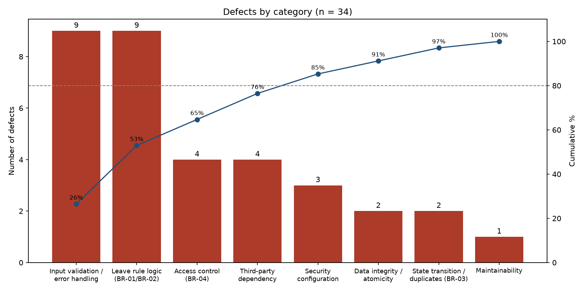
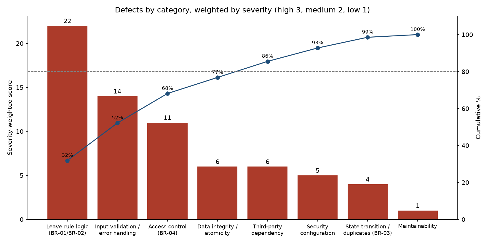
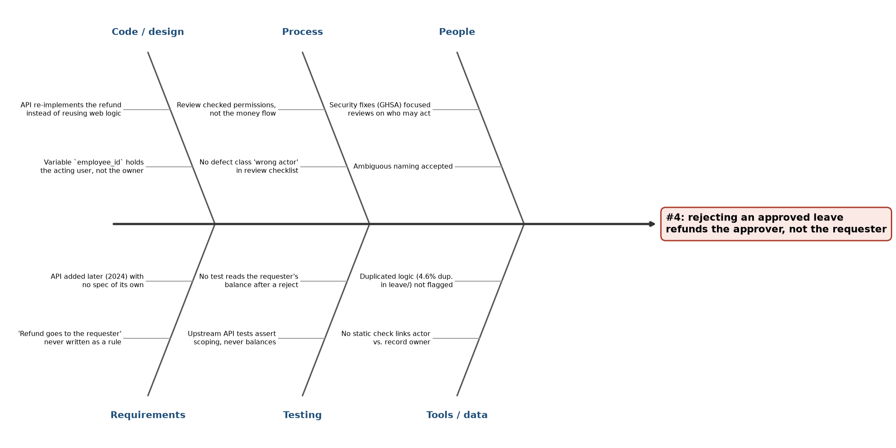
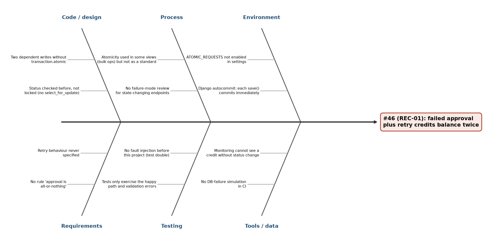

SE3002 Software Quality Engineering · Fall 2026 · Section SE-5B

# Final Project Report

Quality engineering of the Horilla HRMS leave module: leave allocation (W1) and leave request (W2)

| Roll no | Name | Owned area |
|---|---|---|
| 24I-3071 | Muhammad Wasay Tariq | Area 1: static analysis, white-box, mutation, CI gate |
| 24I-3000 | Syed Muhammad Rayyan Hassan | Area 2: API and integration testing, OpenAPI, test data generator |
| 24I-3130 | Zain bin Jabir | Area 3: use cases, usability and accessibility, security, performance and recovery |

System under test: Horilla HRMS 2.4.0 (Django 5.2.19) 
Public repository: <a href="https://github.com/includeduck/SQE-Horilla-Project">github.com/includeduck/SQE-Horilla-Project</a> (branch <code>sqe-team</code>) 
Report date: {{DATE}}

## Contents

{{TOC}}

# 1. Introduction and scope

## 1.1 System under test

Horilla is an open-source HR management system (Python/Django, server-rendered pages with HTMX, a JWT REST API under `/api/`). We tested release **2.4.0** in its **leave module**. The full scope, requirements, business rules, roles and oracle decisions are in [SCOPE.md](../SCOPE.md) (Appendix A).

| Workflow | What it does | Main screens / API |
|---|---|---|
| **W1 Leave allocation** (balance is granted) | An employee asks for extra days of a leave type; an approver approves (balance credited) or rejects with a reason | *Leave Allocation Requests*; `/api/leave/allocation-request/`, `/api/leave/allocation-approve/<id>/`, `/api/leave/allocation-reject/<id>/` |
| **W2 Leave request** (balance is consumed) | An employee requests leave for dates; it is checked against the balance and existing leave; an approver approves (balance debited) or rejects (balance refunded) | *My Leave Requests*, *Leave Requests*; `/api/leave/request/`, `/api/leave/approve/<id>/`, `/api/leave/reject/<id>/` |
| **Shared record** | Both workflows read and write the same `AvailableLeave` row (available days, carry-forward days) | `/api/leave/available-leave/` |

## 1.2 Test basis

| ID | Requirement / rule (short) |
|---|---|
| FR-01 – FR-05 | W1: create, view, edit (while requested), approve (credit), reject (reason, no credit) an allocation request |
| FR-06 – FR-10 | W2: create with balance check, overlap check, approve (debit), reject (refund), cancel |
| **BR-01** | A request may not exceed the effective balance (available + capped carry-forward + forecast) and must have a positive effective duration |
| **BR-02** | No overlapping leave for the same employee (half-day exceptions) |
| **BR-03** | Only the allowed state transitions (requested → approved / rejected / cancelled; terminal states stay terminal) |
| **BR-04** | Employees see and change only their own requests; only approvers decide, never on their own request |

Two oracle questions were decided by the team and recorded in SCOPE §7: **OD-01** cancelled is terminal (it cannot be rejected afterwards) and **OD-02** an identical pending allocation request is a duplicate and is refused.

**Out of scope:** other Horilla modules, multi-level conditional approval chains, production configuration (PostgreSQL, gunicorn), load above 5 users, and active (offensive) security testing. Reasons and residual effects are in the completion report §3 (Appendix O).

# 2. Team and area ownership

| Area (brief §6) | Owner (credited) | Work carried out by |
|---|---|---|
| **Area 1:** SonarQube, white-box unit tests (coverage, MCC, MC/DC), mutation testing, CI quality gate | Muhammad Wasay Tariq (24I-3071) | Wasay |
| **Area 2:** API and integration testing, OpenAPI specification, EP/BVA test-data generator and regeneration | Syed Muhammad Rayyan Hassan (24I-3000) | Rayyan |
| **Area 3:** use cases + Playwright automation, usability and accessibility, defensive security, performance and recovery | **Zain bin Jabir (24I-3130)**, as recorded in [TEAM.md](../TEAM.md) | Rayyan and Wasay, **by team agreement** (26 Nov 2026) |
| **Shared:** test plan, estimation, risk register, exit criteria, traceability, defect management and RCA, progress and completion reports, AI-use record | All three | Rayyan and Wasay |

Area 3 remains credited to Zain bin Jabir as the owner listed in TEAM.md. Because his capacity was reduced, the team agreed that Rayyan would take as much of Area 3 as he could and Wasay the rest (TEST_PLAN §3, control action C2-1). Rayyan delivered the use cases UC-RAY-01/02 with ten browser flows; Wasay delivered UC-WAS-01/02 with ten browser flows, accessibility, security, and performance and recovery. Each report names the person who did the work, and the commit history on GitHub shows the same.

# 3. Test management

The test-management documents are reproduced in full in the appendices: [test plan](../TEST_PLAN.md) (B), [risk register](../RISK_REGISTER.md) (C), [traceability matrix](../TRACEABILITY_MATRIX.md) (§5), weekly progress reports (M, N) and the [test completion report](../reports/TEST_COMPLETION_REPORT.md) (O).

## 3.1 Test plan summary

| Item | Summary |
|---|---|
| Approach | Risk-based: the technique and depth for each part follow the risk score (risk register §5). High risks (PR-01 – PR-04) get white-box + MC/DC + mutation + API state tests + browser flows; medium risks get API and boundary tests; low risks get one level |
| Levels | Unit (white-box), API/integration, browser (use cases), plus non-functional: accessibility, security, performance, recovery |
| Environment | Windows 11 + Python 3.12 venv (app, unit, browser); WSL Ubuntu (mutation, needs `fork()`); GitHub Actions (all suites on every PR). SQLite with a seeded snapshot restored by `scripts/team/reset.ps1` |
| Test data | Synthetic only: `scripts/team/seed_team.py` (accounts `team_employee`, `team_approver`, an outsider), generated API inputs from the OpenAPI spec; no real personal data |
| Schedule | 18–28 Nov 2026; testing ran 23–26 Nov, finalisation 27–28 Nov (progress reports) |
| Entry / exit | Entry: seeded build starts and smoke test passes. Exit: EC-1 – EC-5 (§3.3) |

**Estimation (three-point, person-hours):** expected effort **E = 102.8 h**, σ = 6.4 h, so **102.8 ± 12.9 h** at about 95% confidence (TEST_PLAN §8). Actual hours are being recorded by each member for their own areas (control action C2-7); the calendar indicator is 6 working days used against 10 planned.

## 3.2 Risk register summary

Likelihood × impact on a 1–5 scale (score 1–25). Full register with mitigations and owners: Appendix C.

| ID | Product risk | L × I = score | Mitigation through testing |
|---|---|---|---|
| **PR-01** | Wrong balance change (credit/debit to the wrong employee, twice, or not at all) | 5 × 5 = **25** | White-box + MC/DC, mutation with custom balance operators, API read-back of all balances, recovery test |
| **PR-02** | Balance boundary wrong (carry-forward cap, forecast, exactly-zero) | 4 × 5 = **20** | BVA at unit and API level, forecast/cap tests, mutation |
| **PR-03** | Cross-employee access (see or change another employee's request) | 4 × 5 = **20** | Access matrix, API ownership tests, use-case exception flows, CSRF review |
| **PR-04** | Invalid state transitions | 4 × 4 = **16** | State-transition tests (all allowed and disallowed), OD-01 |
| PR-05 | Malformed input causes a server error (500) | 3 × 5 = 15 | Generated invalid inputs on every API input |
| PR-06 | Duplicate records on repeated requests | 3 × 4 = 12 | Repeated-request tests, OD-02, recovery retry |
| PR-07 | Day counting wrong (holidays, company leave, half days) | 3 × 4 = 12 | Basis-path tests, custom `day_breakdown_swap` mutants |
| PR-08 | Overlap check wrong | 3 × 4 = 12 | 20-row MCC of the half-day exception |
| PR-09 | Vulnerable dependencies | 3 × 3 = 9 | pip-audit, ZAP library check |
| PR-10 | Slow balance read | 2 × 3 = 6 | k6 at 1 and 5 users |
| PR-11 | Accessibility barriers on the leave forms | 3 × 2 = 6 | axe-core + Lighthouse, fix of one screen |

Project risks: **PJ-01** schedule (16), **PJ-02** member capacity (16, realised and handled by re-planning), **PJ-03** AI-generated work not understood (15), **PJ-04** environment differences (Windows/WSL/CI), **PJ-05** CI capacity.

## 3.3 Exit criteria

| ID | Criterion | Target | Risks |
|---|---|---|---|
| **EC-1** (release) | Business-logic test strength | 100% statement + branch of the 15 scoped functions, mutation ≥ 95%, 0 unexplained survivors | PR-01, PR-02 |
| **EC-2** (release) | Cross-employee access and state safety | 100% of access-matrix and state-transition tests pass, 0 open high-severity defects in PR-01/03/04 | PR-01, PR-03, PR-04 |
| **EC-3** (release) | Performance of the selected operation | p95 ≤ 500 ms and < 1% unexpected failures at 5 concurrent users | PR-10 |
| EC-4 | No server errors on invalid input | 0 HTTP 500 across generated invalid-input API cases | PR-05 |
| EC-5 | Accessibility of the fixed screen | 0 critical/serious axe-core violations after the fix | PR-11 |

Actual vs target is in §8.

# 4. Results per testing activity

## 4.1 Static analysis: SonarQube (Area 1)

SonarQube Community Build 26.10 on `sqe-team`, "Sonar way core" profile. Full report: Appendix D.

| Metric | Whole project | `leave/` | `api_views/leave/` |
|---|---|---|---|
| Lines of code | 230,396 | 14,470 | 1,102 |
| Cyclomatic complexity | 33,040 | 1,947 | 184 |
| Duplication | 2.9% | **4.6%** | 2.1% |
| Bugs / reliability rating | 38 / E | 1 / E | 1 / C |
| Vulnerabilities / security rating | 62 / D | 0 / A | 0 / A |
| Maintainability rating, debt | A, 298 min | A, 2 min | A, 0 |
| Coverage (baseline) | 0.0% | 0.0% | 0.0% |

- The leave module is small and rated A for maintainability and security. Its E reliability rating comes from one blocker finding (`leave/views.py:143`, S5644), which manual review judged a likely false positive.
- The leave module's duplication (4.6%) is above the project average. A copied balance calculation is the root cause of A2-D03 (§7).
- **Hand-calculated cyclomatic complexity** of `calculate_requested_days` from its control-flow graph is **6**, which matches SonarQube's value (Appendix D §6).
- In CI, a ratchet quality gate (`docs/team/ci/gate-thresholds.json`) fails the build if any measure gets worse than the baseline.

## 4.2 White-box unit testing (Area 1)

Full report: Appendix E; MCC and MC/DC tables: Appendix F.

| Item | Result |
|---|---|
| Scope | The **15 functions** that implement BR-01 – BR-04 and the approve/reject arithmetic (`tests/team/unit/coverage_scope.py`) |
| Tests | **160 unit tests** pass (in-memory SQLite, about 1 min), plus 5 recovery tests (§4.9) |
| Coverage | **100% statement and branch** of every scoped function. 1 line and 2 branches are infeasible and justified in Appendix E §4 |
| MCC / MC-DC | Critical decision: the overlap check with its half-day exception (BR-02). Complete MCC with 20 rows, and MC/DC independence pairs for every condition, each linked to a test |
| Business rules | All four rules covered, with BVA at the balance boundary (0, exactly enough, one over) |
| Defects | **#11** (A1-D01): a missing end date crashes validation with a `TypeError` (fixed: end date defaults to start date). **#12** dead code, **#13** unknown carry-forward type uncapped |

## 4.3 Mutation testing (Area 1)

mutmut 3.8.1 in WSL on the 15 scoped functions. Full report: Appendix G.

| Item | Result |
|---|---|
| Custom operators (business rules) | `leave_state_swap` (BR-03: swaps leave states), `balance_term_drop` (BR-01: drops one term of the effective balance), `day_breakdown_swap` (PR-07: swaps full/first-half/second-half) |
| Score | **97.9%**: 465 of 475 killed, 10 survived |
| Survivors analysed | All **10** survivors, plus the 15+ killable survivors from the first run, which were killed by new tests or stronger assertions |
| Unexplained survivors | **0**: all 10 remaining survivors are documented equivalents (`docs/team/ci/mutation-equivalents.json`) |
| Limitation | mutmut 3 does not mutate decorated functions, so the three decorated `put` methods have no mutants. They are covered 100% by unit tests |

## 4.4 CI quality gate (Area 1)

Full report: Appendix H. Workflow: `.github/workflows/quality-gate.yml` on every pull request into `sqe-team`.

| Job | Fails when |
|---|---|
| `unit` | any unit test fails, or a scoped function is below 100% statement/branch |
| `api` | any of Area 2's API cases fails (16 shards × 2 test orders) |
| `e2e` | any Playwright use-case flow fails |
| `sonar` | the SonarQube 26.10 gate (ratchet on the baseline) is not OK |
| `mutation` | score < 95%, or any survivor that is not a documented equivalent |
| `gate` (required check) | any job above is not `success` (skipped and cancelled also fail) |
| `deploy` | runs only on a push to `sqe-team` after `gate` succeeded |

The workflow has no escape hatches: no `continue-on-error` and no `|| true`. The `gate` check is required and branch protection applies to administrators too (`enforce_admins`), so the repository owner cannot bypass it either.

- **Blocked PR:** [PR #34](https://github.com/includeduck/SQE-Horilla-Project/pull/34) deleted one forecast-balance test. Unit tests and coverage stayed green, and the mutation score was 97.3%, still above the threshold. The mutation job failed on **3 unexplained survivors**, which blocked the merge. Coverage and a score threshold alone would have let this PR through.
- **Documented fix (fails before, passes after):** [PR #35](https://github.com/includeduck/SQE-Horilla-Project/pull/35) fixes #11. The new test fails on the original code and passes with the fix, and the gate is green.

## 4.5 API and integration testing (Area 2)

By Syed Muhammad Rayyan Hassan. Full reports: Appendix I (completion report, coverage matrix, defects).

| Item | Result |
|---|---|
| Specification | Scoped OpenAPI document of the **34 leave and allocation operations** of W1/W2, reconstructed from the source |
| Generator | Deterministic EP + 3-point BVA generator from the OpenAPI spec; **713/713** generated case IDs executed; **350/350** input families covered |
| Techniques | Equivalence partitioning, boundary values, decision tables (FR/BR), state transitions (all allowed and disallowed), repeated requests, read-back of persisted state and all affected balances |
| Execution | **3,433 API cases pass** in each of two test orders (first and reversed), sharded in CI |
| Regeneration demo | A controlled change of two constraints in the spec: the baseline had 6 passes, and the regenerated variant predicted exactly 2 strict failures, which then failed as predicted |
| Defects | 22 API defects (#3 – #6, #14 – #30) and one browser defect (#31), all **fixed and verified** (§6) |

## 4.6 Use cases and browser automation (Area 3)

Four use cases (main, two alternative and two exception flows each), with every flow automated in Playwright. Full specifications: Appendix J.

| Use case | Actor | Author | Flows | Result |
|---|---|---|---|---|
| UC-RAY-01 Request a leave allocation | Employee | Rayyan | 5 | 5/5 pass |
| UC-RAY-02 Request leave | Employee | Rayyan | 5 | 5/5 pass |
| UC-WAS-01 Decide an allocation request | Approver | Wasay | 5 | 5/5 pass |
| UC-WAS-02 Decide a leave request | Approver | Wasay | 5 | 5/5 pass |

Each test checks what the screen shows and then the postconditions through the API: the request status, the requester's balance, and that the approver's and an unrelated employee's balances did not change. The exception flows cover a rejection without a reason (blocked by required-field validation) and an employee approving their own request (refused with "no permission").

## 4.7 Usability and accessibility (Area 3)

By Wasay. Full report: Appendix K.

- **Task tests (Playwright):** a W1 keyboard-only test tabs through the allocation form and checks the focus order. A W2 correction test submits a 5-day request against a 3-day balance, checks the BR-01 error, then corrects the request and submits it.
- **Tools:** axe-core 4.14.1 and Lighthouse 13.6.0 on the key screens of both workflows.

| Screen | Lighthouse accessibility | axe critical / serious |
|---|---|---|
| **My Leave Requests (fixed screen)** | **71 → 99** | 2 / 7 → **0 / 0** |
| Leave Allocation Requests (shares the fixed layout) | 71 → 92 | 2 / 6 → 0 / 1 |

There were 13 accessibility issues (A11Y-01 – A11Y-13) and 3 usability findings (UX-01 – UX-03). Most of them came from the shared page layout, so the fix was made in Horilla's own templates: `lang`, `role="main"`, button and link names, contrast tokens, and labels for Select2, icons and checkboxes. `AXE_STRICT=1` keeps the fixed screen at 0 critical/serious violations.

## 4.8 Defensive security (Area 3)

By Wasay. Full report: Appendix K.

| Check | Result |
|---|---|
| Access matrix (Playwright, 6 decisions: own vs other employee, employee vs approver, self-approval) | **6/6** as expected; no cross-employee read or change |
| Session and cookie settings, CSRF review | `HttpOnly`, `SameSite=Lax`; weakness **SEC-01**: the web allocation approval changes state on a GET, so CSRF protection does not apply |
| OWASP ZAP 2.17.0 passive scan (logged in) | moment.js 2.29.1 (SEC-03), no CSP (SEC-02), CDN scripts without SRI (SEC-04), CSRF token in a URL (SEC-07) |
| pip-audit 2.10.1 (178 packages) | pdfkit advisory without a fix (SEC-05), svglib DoS (SEC-06) |

All seven findings are logged as issues #38 – #44, with severity, risk link and proposed fix (§6).

## 4.9 Performance and recovery (Area 3)

By Wasay. Full report: Appendix K.

**Operation:** `GET /api/leave/available-leave/`, the shared balance read of W1 and W2. The limits were set before the first run: **p95 ≤ 500 ms** and **< 1%** unexpected failures. The tool was k6 v2.4.0: 10 s warm-up, then 60 s at steady state, with each workload run twice.

| Run | Users | p95 (ms) | Median (ms) | Requests/s | Unexpected failures |
|---|---|---|---|---|---|
| 1 VU, run 1 | 1 | 15.9 | 13.0 | 1.00 | 0.0% |
| 1 VU, run 2 | 1 | 16.0 | 12.9 | 1.00 | 0.0% |
| 5 VU, run 1 | 5 | 28.2 | 15.4 | 4.93 | 0.0% |
| 5 VU, run 2 | 5 | **39.1** | 18.7 | 4.92 | 0.0% |

**Failure and recovery:** a test double makes the database fail during an approval. The test then checks the persisted state, restores the database, retries, and checks the final state for duplicates.

| Case | Before the fix | After the fix (#46) |
|---|---|---|
| W1 approval fails at the 1st write (credit) | pass | pass |
| W1 approval fails at the 2nd write (status) | **fail: balance 5 → 8 with status "requested"; the retry credits again, to 11** | pass: balance unchanged after the failure, credited once after the retry |
| Retry after a successful approval | pass (refused, 400) | pass |
| W2 approval fails at the 2nd write | **fail: debited with status "requested"** | pass |

This is **REC-01 (#46, high)**: the approval made two dependent writes without a transaction. The fix adds `@transaction.atomic` and `select_for_update()` to the four API approve/reject endpoints and the web allocation approval. The evidence is `docs/team/evidence/recovery/fix-46-before.txt` (2 failed) and `fix-46-after.txt` (5 passed).

# 5. Traceability

Generated by `scripts/team/traceability.py` from the test files. Every requirement is linked to the tests that verify it at each level. **14/14** requirements and rules are covered by passing tests, all at two or more levels and **11/14** at unit + API + browser level. FR-01 has no unit test because its logic sits in the API serializer, and FR-04 and FR-07 have no browser flow. The full table follows.

<!-- include: ../TRACEABILITY_MATRIX.md shift=1 strip-title -->

# 6. Findings: root cause, severity, risk and fix

All defects are GitHub issues in the public repository, labelled with severity, priority, triage, category and source. Raw log: `docs/team/defects/DEFECT_LOG.csv`. Fixed issues are closed only after their regression test passes in the required gate (`status:fixed-verified`).

## 6.1 API and integration findings (Area 2)

| Issue | Finding | Root cause | Severity | Risk | Fix / status |
|---|---|---|---|---|---|
| [#4](https://github.com/includeduck/SQE-Horilla-Project/issues/4) A2-D01 | Rejecting approved leave refunds the **approver** instead of the requester | Reject handler passed `request.user.employee_get` (the actor) to the refund lookup | High | PR-01 | Refund the leave's own employee; fixed, verified |
| [#5](https://github.com/includeduck/SQE-Horilla-Project/issues/5) A2-D02 | Foreign-owned self-allocation PUT/DELETE return 500 | Getter returned `None` for a foreign record, which was then dereferenced | High | PR-03 | Controlled 403/404; fixed, verified |
| [#6](https://github.com/includeduck/SQE-Horilla-Project/issues/6) A2-D03 | API leave creation ignores the carry-forward cap | Serializer's own balance sum used raw carry-forward (duplicate of the model rule) | High | PR-02 | Use the model's capped effective balance; fixed, verified |
| [#14](https://github.com/includeduck/SQE-Horilla-Project/issues/14) A2-P3-01 | Zero/negative effective duration accepted | Serializer lacked the model's positive-duration check | High | PR-01, PR-07 | Same check as the model; fixed, verified |
| [#15](https://github.com/includeduck/SQE-Horilla-Project/issues/15) A2-P3-02 | Another employee's holiday excluded; over-balance accepted | Day count computed without the employee context | High | PR-07, PR-02 | Pass the requesting employee; fixed, verified |
| [#16](https://github.com/includeduck/SQE-Horilla-Project/issues/16) A2-P3-03 | Valid forecast entitlement refused at the reset boundary | Forecast term missing in the API balance check | Medium | PR-02 | Include forecast; fixed, verified |
| [#17](https://github.com/includeduck/SQE-Horilla-Project/issues/17) A2-P3-04 | Complementary half-day requests rejected as overlapping | Overlap check ignored the day breakdown | Medium | PR-08 | Breakdown-aware overlap; fixed, verified |
| [#18](https://github.com/includeduck/SQE-Horilla-Project/issues/18) A2-P3-05 | Approval ignores current carry-forward policy/cap | Approval re-validated with the uncapped sum | High | PR-02 | Capped effective balance; fixed, verified |
| [#19](https://github.com/includeduck/SQE-Horilla-Project/issues/19) A2-P3-06 | Malformed rejection deducts balance before returning 400 | Balance write happened before input validation | High | PR-01 | Validate first, then write; fixed, verified |
| [#20](https://github.com/includeduck/SQE-Horilla-Project/issues/20) A2-P3-07 | Owner can transfer a request to another employee | Generic update accepted `employee_id` from the body | High | PR-03 | Server-owned identity; fixed, verified |
| [#24](https://github.com/includeduck/SQE-Horilla-Project/issues/24) A2-P2-04 | Generic allocation create accepts a foreign employee | No ownership check on create | High | PR-03 | Ownership check; fixed, verified |
| [#25](https://github.com/includeduck/SQE-Horilla-Project/issues/25) A2-P2-05 | Zero detail IDs lose the route argument in permission dispatch | Falsy-ID check in the decorator | Medium | PR-03 | Explicit `None` check; fixed, verified |
| [#3](https://github.com/includeduck/SQE-Horilla-Project/issues/3), [#21](https://github.com/includeduck/SQE-Horilla-Project/issues/21) – [#23](https://github.com/includeduck/SQE-Horilla-Project/issues/23), [#26](https://github.com/includeduck/SQE-Horilla-Project/issues/26) – [#28](https://github.com/includeduck/SQE-Horilla-Project/issues/28) | Seven malformed inputs return **HTTP 500** (attachment names at 99/100 chars, malformed IDs, non-object bodies, bad `groupby_field`, filter choices, sessionless JWT HTML, date filters) | Input parsed or cast without validation before use | Medium/Low | PR-05 | Validate and return 400; fixed, verified (EC-4) |
| [#29](https://github.com/includeduck/SQE-Horilla-Project/issues/29) A2-D04 | Identical pending allocation requests create duplicates | No identity rule for a pending request (decided as OD-02) | Medium | PR-06 | Refuse the duplicate (400); fixed, verified |
| [#30](https://github.com/includeduck/SQE-Horilla-Project/issues/30) A2-D05 | Cancelled leave can be rejected | Terminal state not guarded (decided as OD-01) | Medium | PR-04 | 400 before any state or refund change; fixed, verified |
| [#31](https://github.com/includeduck/SQE-Horilla-Project/issues/31) A2-D10 | Browser allocation form accepts an empty amount | Field not required in the form | Medium | PR-05 | Required field; fixed, verified |

## 6.2 White-box findings (Area 1)

| Issue | Finding | Root cause | Severity | Risk | Fix / status |
|---|---|---|---|---|---|
| [#11](https://github.com/includeduck/SQE-Horilla-Project/issues/11) A1-D01 | Leave request without an end date crashes validation (`TypeError`) | `clean()` compares dates before the end date is defaulted | Medium | PR-05 | Default end date to start date in `clean()` (PR #35); closes with PR #52 |
| [#12](https://github.com/includeduck/SQE-Horilla-Project/issues/12) A1-D02 | Dead code in the month/year comparison | Condition can never be true (found by branch coverage) | Low | maintainability | Deferred |
| [#13](https://github.com/includeduck/SQE-Horilla-Project/issues/13) A1-D03 | Unknown carry-forward type adds carry-forward uncapped | Fall-through branch with no cap | Low | PR-02 | Accepted for release (needs invalid data) |

## 6.3 Security findings (Area 3)

| Issue | Finding | Root cause | Severity | Risk | Fix / status |
|---|---|---|---|---|---|
| [#38](https://github.com/includeduck/SQE-Horilla-Project/issues/38) SEC-01 | Web allocation approval changes state on a plain GET (CSRF bypass) | View has no method restriction; approval implemented as a link | Medium | PR-03, PR-01 | `@require_POST` + HTMX `hx-post` with token; next cycle (first) |
| [#39](https://github.com/includeduck/SQE-Horilla-Project/issues/39) SEC-02 | No Content-Security-Policy on any page | No CSP middleware or header configured | Medium | PR-03 | Add CSP (report-only first); next cycle |
| [#40](https://github.com/includeduck/SQE-Horilla-Project/issues/40) SEC-03 | Vulnerable moment.js 2.29.1 bundled | Vendored static file never updated | Medium | PR-09 | Upgrade to 2.30.1; next cycle |
| [#41](https://github.com/includeduck/SQE-Horilla-Project/issues/41) SEC-04 | CDN scripts without Subresource Integrity | `<script src>` without `integrity`/`crossorigin` | Medium | PR-09 | SRI hashes or self-host; next cycle |
| [#42](https://github.com/includeduck/SQE-Horilla-Project/issues/42) SEC-05 | pdfkit 1.0.0 advisory, no upstream fix | Unmaintained library with local file access | Low | PR-09 | Replace pdfkit; deferred (outside the workflows) |
| [#43](https://github.com/includeduck/SQE-Horilla-Project/issues/43) SEC-06 | svglib 1.5.1 DoS advisory | Unpinned transitive dependency | Low | PR-09 | Pin `svglib>=2.3.1`; next cycle |
| [#44](https://github.com/includeduck/SQE-Horilla-Project/issues/44) SEC-07 | CSRF token sent in a GET query string | Front-end serialises the whole form into the URL | Low | PR-03 | Send the token in `X-CSRFToken`; next cycle |

## 6.4 Accessibility and usability findings (Area 3)

These are recorded in the accessibility report (Appendix K) rather than as issues, because they are fixed or proposed per screen.

| ID | Finding | Root cause | Severity (axe) | Risk | Fix / status |
|---|---|---|---|---|---|
| A11Y-02, A11Y-05 | Buttons and Select2 controls without an accessible name | Icon-only buttons; Select2 replaces the labelled `<select>` | Critical | PR-11 | `aria-label`, label copied from the `<select>`; **fixed** |
| A11Y-03 | Low colour contrast (white on brand red 3.81:1, grey hints 2.53:1) | Theme colour tokens below 4.5:1 | Serious | PR-11 | Darker theme tokens; **fixed** |
| A11Y-01, A11Y-09 | No page language; no main landmark | Shared base template | Serious / moderate | PR-11 | `lang`, `role="main"`; **fixed** |
| A11Y-04, A11Y-06, A11Y-07, A11Y-08 | Unnamed icons, title-only checkboxes, empty link, link inside a button | Runtime-generated widgets and the header template | Serious | PR-11 | Fixed in the templates and re-applied after HTMX swaps; **fixed** |
| A11Y-10 – A11Y-13 | No `<h1>`, skipped heading level, redundant alt, unnamed dialog | Page structure | Moderate / minor | PR-11 | Next cycle |
| UX-01 | Creating an allocation says "updated" | Create and update share one message | Usability | PR-04 | Separate message; proposed |
| UX-02 | First-visit tour blocks the page | driver.js tour on task screens | Usability | PR-11 | "Skip tour" control; proposed |
| UX-03 | Balance error does not say by how much | Message omits the available days | Usability | PR-02 | Include available days; proposed |

## 6.5 Performance and recovery findings (Area 3)

| Issue | Finding | Root cause | Severity | Risk | Fix / status |
|---|---|---|---|---|---|
| (none) | Balance read meets both limits (worst p95 39.1 ms, 0% failures) | n/a | n/a | PR-10 | No action |
| [#46](https://github.com/includeduck/SQE-Horilla-Project/issues/46) REC-01 | A failed approval plus a retry credits (or debits) the balance twice | Two dependent writes without `transaction.atomic`; `ATOMIC_REQUESTS` off | **High** | PR-01, PR-06 | `@transaction.atomic` + `select_for_update()` (PR #51); fails before, passes after; closes with PR #52 |

# 7. Defect analysis

Full analysis with the defect log: Appendix L.

**33 defects** in total: **10 high, 14 medium, 9 low**. They were found by API tests (22), security testing (7), white-box testing (3), the browser (1, #31) and recovery testing (1, #46).

Two categories, **input validation** and **leave-rule logic**, account for most defects, both by count and when weighted by severity. Both point to the same cause: the API serializer re-implements validation that the model already has, and the two copies have drifted apart. Root-cause analysis with 5 whys and fishbone diagrams was done for the two most important defects:

- **#4 (refund to the wrong employee).** The handler used the acting user as the balance owner. Status-only assertions could not detect this. The control is to read back every affected employee's balance in each test, which is now standard in the API and browser suites.
- **#46 (double credit after a failure).** Two dependent writes ran without a transaction, and no test injected a failure between them. The control is the recovery test with a test double, which now runs in the required gate.

**Metrics (GQM):** defect density 2.1 per KLOC in the scoped code (high severity 0.64/KLOC); requirements coverage 14/14; reopen rate **0%**; 22 of 33 defects closed before the integration merge, and #11 and #46 close with it.

# 8. Release decision

## 8.1 Release criteria: actual vs target

| Criterion | Target | Actual | Met? |
|---|---|---|---|
| **EC-1** Business-logic test strength | 100% statement + branch of the 15 scoped functions; mutation ≥ 95%; 0 unexplained survivors | **100%** statement + branch (1 line and 2 branches infeasible, justified); mutation **97.9%** (465/475), **0** unexplained survivors | **Yes** |
| **EC-2** Access and state safety | 100% of access-matrix and state-transition tests pass; 0 open high-severity defects in PR-01/03/04 | Access matrix **6/6**; all state-transition API cases pass in both orders; use-case flows **20/20**; the only open high defect, **#46, is fixed** (recovery tests 2 failing before, 5/5 after) and closes when PR #52 is merged | **Yes, with PR #52 merged** |
| **EC-3** Performance | p95 ≤ 500 ms and < 1% unexpected failures at 5 users | Worst of 4 runs: **p95 39.1 ms**, **0.0%** failures | **Yes** |
| EC-4 No 500 on invalid input | 0 HTTP 500 across generated invalid inputs | 3,433 API cases pass in both orders; all seven 500 defects fixed and verified | Yes |
| EC-5 Accessibility of the fixed screen | 0 critical/serious axe violations | **0 / 0** (was 2 / 7); Lighthouse 71 → 99 | Yes |

## 8.2 Decision

**{{DECISION}}**

{{DECISION_TEXT}}

- **Open defects that do not block the release:** #38 – #41 (medium, security hardening) and #12, #13, #42 – #44 (low). #38 (state change on GET) should come first in the next cycle because it is in the same high-risk area, PR-03.
- **Residual risk:** PR-03 and PR-09 stay **medium** until the security findings are fixed. PR-01 is **low** once the #46 fix is merged. Behaviour on PostgreSQL and in production configuration was not tested; this matters for the locking in the #46 fix.

# 9. AI-use record

The full record, as kept in the repository ([AI_USE_RECORD.md](../AI_USE_RECORD.md)), with the tool, purpose, output, and what we checked or changed for each use:

<!-- include: ../AI_USE_RECORD.md shift=1 strip-title -->

# 10. Evidence and links

Public repository: **<https://github.com/includeduck/SQE-Horilla-Project>** (branch `sqe-team`). Defects: [Issues](https://github.com/includeduck/SQE-Horilla-Project/issues). CI runs: [Actions](https://github.com/includeduck/SQE-Horilla-Project/actions).

| Activity | Report | Raw evidence | Tests / scripts |
|---|---|---|---|
| Static analysis | [SONARQUBE_BASELINE.md](../reports/SONARQUBE_BASELINE.md) | [evidence/sonar/](../evidence/sonar/) | `sonar-project.properties`, [tests/team/ci/sonar_gate.py](../../../tests/team/ci/sonar_gate.py) |
| White-box unit | [WHITEBOX_UNIT_TESTING.md](../reports/WHITEBOX_UNIT_TESTING.md), [MCC_MCDC_TABLES.md](../reports/MCC_MCDC_TABLES.md) | [evidence/unit-coverage-scope.txt](../evidence/unit-coverage-scope.txt) | [tests/team/unit/](../../../tests/team/unit/) |
| Mutation | [MUTATION_TESTING.md](../reports/MUTATION_TESTING.md) | [evidence/mutation/](../evidence/mutation/) | [tests/team/mutation/](../../../tests/team/mutation/) |
| CI quality gate | [CI_QUALITY_GATE.md](../reports/CI_QUALITY_GATE.md) | PR #34 (blocked), PR #35 (fix) | [.github/workflows/quality-gate.yml](../../../.github/workflows/quality-gate.yml) |
| API and integration | [AREA2_COMPLETION_REPORT.md](../reports/AREA2_COMPLETION_REPORT.md), [API_COVERAGE_MATRIX.md](../API_COVERAGE_MATRIX.md) | [evidence/area2/](../evidence/area2/) | [tests/team/api/](../../../tests/team/api/) |
| Use cases | [RAYYAN_USE_CASES.md](../RAYYAN_USE_CASES.md), [WASAY_USE_CASES.md](../WASAY_USE_CASES.md) | [evidence/use-cases-wasay/](../evidence/use-cases-wasay/) | [tests/team/e2e/](../../../tests/team/e2e/) |
| Accessibility | [ACCESSIBILITY_TESTING.md](../reports/ACCESSIBILITY_TESTING.md) | [evidence/a11y/](../evidence/a11y/) | [tests/team/a11y/](../../../tests/team/a11y/) |
| Security | [SECURITY_ASSESSMENT.md](../reports/SECURITY_ASSESSMENT.md) | [evidence/security/](../evidence/security/) | [tests/team/security/](../../../tests/team/security/) |
| Performance and recovery | [PERFORMANCE_TESTING.md](../reports/PERFORMANCE_TESTING.md) | [evidence/perf/](../evidence/perf/), [evidence/recovery/](../evidence/recovery/) | [tests/team/perf/](../../../tests/team/perf/), [tests/team/recovery/](../../../tests/team/recovery/) |
| Traceability, defects | [TRACEABILITY_MATRIX.md](../TRACEABILITY_MATRIX.md), [DEFECT_ANALYSIS.md](../reports/DEFECT_ANALYSIS.md) | [defects/DEFECT_LOG.csv](../defects/DEFECT_LOG.csv) | [scripts/team/](../../../scripts/team/) |

How to reproduce: [SETUP.md](../SETUP.md) (environment, seed, reset) and the "How to run" section of each report.

<!-- appendices -->

<!-- appendix: A | Test scope and test basis | ../SCOPE.md from="# Test Scope" -->
<!-- appendix: B | Test plan | ../TEST_PLAN.md -->
<!-- appendix: C | Risk register | ../RISK_REGISTER.md -->
<!-- appendix: D | SonarQube baseline | ../reports/SONARQUBE_BASELINE.md from="# SonarQube Baseline" -->
<!-- appendix: E | White-box unit testing | ../reports/WHITEBOX_UNIT_TESTING.md from="# White-box Unit Testing" -->
<!-- appendix: F | MCC and MC/DC tables | ../reports/MCC_MCDC_TABLES.md -->
<!-- appendix: G | Mutation testing | ../reports/MUTATION_TESTING.md -->
<!-- appendix: H | CI quality gate | ../reports/CI_QUALITY_GATE.md -->
<!-- appendix: I | API and integration testing (Area 2) | ../reports/AREA2_COMPLETION_REPORT.md ; ../API_COVERAGE_MATRIX.md ; ../reports/AREA2_DEFECTS.md -->
<!-- appendix: J | Use cases | ../RAYYAN_USE_CASES.md ; ../WASAY_USE_CASES.md -->
<!-- appendix: K | Usability, accessibility, security, performance and recovery | ../reports/ACCESSIBILITY_TESTING.md ; ../reports/SECURITY_ASSESSMENT.md ; ../reports/PERFORMANCE_TESTING.md -->
<!-- appendix: L | Defect analysis | ../reports/DEFECT_ANALYSIS.md -->
<!-- appendix: M | Weekly progress report, week 1 | ../reports/PROGRESS_REPORT_WEEK1.md -->
<!-- appendix: N | Weekly progress report, week 2 | ../reports/PROGRESS_REPORT_WEEK2.md -->
<!-- appendix: O | Test completion report | ../reports/TEST_COMPLETION_REPORT.md -->
