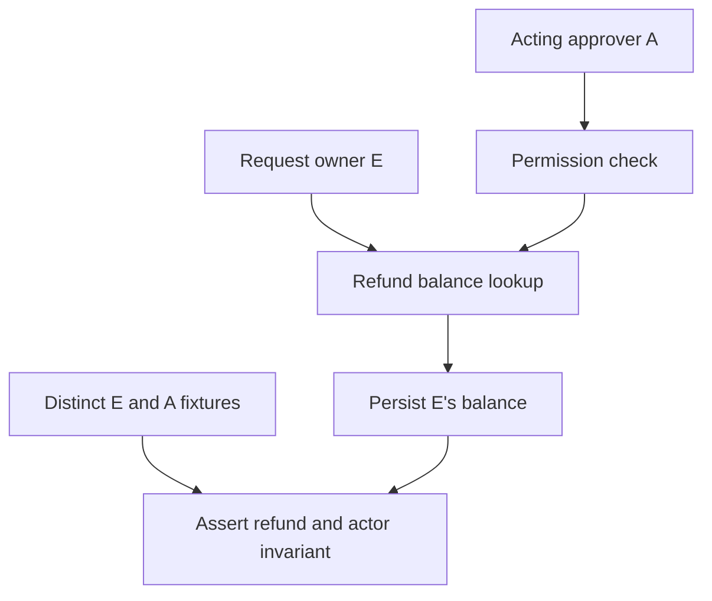
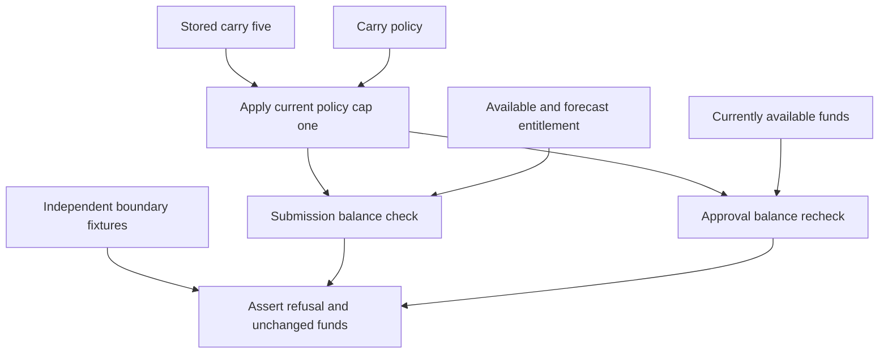
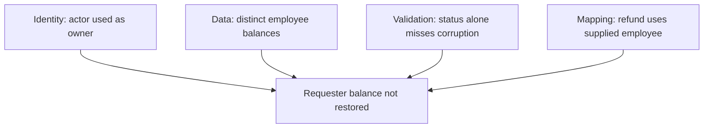
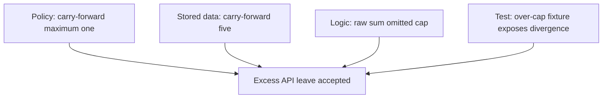

## Final execution closeout — 25 November 2026

Rayyan's project execution assignment is finished. **Whole-project release: HOLD.** No further technical execution or additional prompt is expected from Rayyan.

The final application/API verification source is `aeed7b7ba049a79589b8e9ac0b4abb52bec28d0e`; Actions checked synthetic merge `801351079aada8c399db2212d9c033737e032e0d` with `sqe-team` base `0a5ac6443dadb50ab5fd6ea749f41dd108a19486`. [Run 45627793460](https://github.com/includeduck/SQE-Horilla-Project/actions/runs/45627793460) verifies **3,433/3,433 API cases in each of two orders**, with zero failures/errors/skips/missing IDs and strict complete-scope acceptance. Each collection is the exact union of 16 fresh isolated deterministic shards; reversal occurs within each shard, not a claim of one monolithic reversed process.

**713/713 generated IDs, all former 399 missing IDs, 350/350 mandatory input families, FR-01–FR-10 and BR-01–BR-04 are verified** from real source-bound assertions. Ten personal browser flows pass; the consuming regeneration has six baseline passes and exactly two predicted strict variant failures with four passes. Separate overlapping populations and full links are in [RAYYAN_FINAL_CLOSEOUT.md](RAYYAN_FINAL_CLOSEOUT.md), the final evidence index and machine ledger. Never sum them into a fictitious unique-test total.

All remaining project execution is **Wasay / Wasay's agent — mandatory**, with exact attempts, dependencies and acceptance in root [handoff.md](../../../handoff.md) and `finish-line/REMAINING_WORK.json`. Current shared gate evidence is genuinely red for missing Sonar service/credentials and mutation runner/policy; supplied units pass. No independent review, merged PR #8, required branch/deploy enforcement, teammate authorship, human effort or passed viva is inferred.

The PDF/ZIP is a **Rayyan contribution, not the final group submission**. Earlier dated results/ownership below are historical and superseded by the final handoff; they do not assign new execution to Rayyan.

---

---

## Historical dated appendix (not current ownership or pending work)

## Verified Prompt 3 result — 25 November 2026

This source-specific result supersedes historical incomplete-input, pending-retest
and unanswered OD-01/OD-02 labels below. On `fecac354c9b5d8ea47ac732a2b089ed3cc148620`,
[run 45609322121](https://github.com/includeduck/SQE-Horilla-Project/actions/runs/45609322121) passed **3,433/3,433 API
cases in EACH independent order**, with no failures, errors, required skips or
missing IDs. The strict complete-scope guard accepted both orders.
**713/713 canonical generated IDs, all former 399 missing IDs, and 350/350
mandatory input families are verified.** Explicit requirement assertion selectors
verify FR-01–FR-10 and BR-01–BR-04; tags or mappings alone are not the evidence.

The authoritative source-bound summaries and individual rows are in
`docs/team/finish-line/PROMPT03_EXECUTION_SUMMARY.json`,
`PROMPT03_REQUIREMENT_EVIDENCE.json`, `PROMPT03_INPUT_LEDGER.json` and
`REMAINING_WORK.json`. The original JUnit, full case execution and generated-ID
ledgers remain in [artifact 15024156843](https://github.com/includeduck/SQE-Horilla-Project/actions/runs/45609322121/artifacts/15024156843).

Separate overlapping populations on the same source passed: 482 business/state/
role/workflow cases; 82 affected upstream tests; 24 original team units; 16
focused regressions; eight focused upstream tests; 182 expanded cases; 238 wire
validation cases; seven advanced-filter cases; 27 further upstream tests plus
two subtests; all ten personal browser flows; two fresh foundations with five
smoke cases each; 68 tooling and four media-reader checks. Regeneration passed
six baseline cases and retained exactly two predicted strict variant failures
with four passes, in its separate controlled experiment. These totals are not
added into a larger unique-case count.

Prompt 3's scoped technical work is complete. **Whole-project release remains
HOLD** pending accepted integration, owner/shared quality gates and Prompt 4's
final integrated/report/package/ownership closeout. PR #8 remains draft/open;
no owner approval, merge, human effort, review or viva is inferred.

## Current causal controls for the two major defects

The original A2-D01/A2-D03 five-why analyses below remain grounded in the exact
failing-before/merged-fix evidence. Their final prevention controls now pass on
the recorded source, including the 482 business cases, both complete orders,
and separate affected upstream tests. The updated 22-defect Pareto below
preserves the historical four/seven-defect populations.

For A2-D01, the evidenced chain is: requester not restored; lookup selected
actor; actor differs from owner; status mutation did not prove owner credit;
a response-only check could miss that corruption. The final point is a
test-design inference, not an invented claim about prior human practice.
The correction uses request.employee_id and the recorded available/carry split.

For A2-D03, the evidenced chain is: excess leave accepted; raw carry five used;
policy cap one omitted; serializer/model rules differed; ordinary under-cap
fixtures would not distinguish them. The final point is a logical inference
from the boundary fixture. Current controls apply the existing policy at
submission and separately recheck current capped funds at approval, protecting
against A2-P3-05 without prematurely crediting forecast entitlement.

These diagrams describe observed source data flow and automated controls.
No unobserved organizational cause, human RCA meeting or owner acceptance is
invented. The actual fixed/closed originals remain distinct from proposed
unmerged corrections in PR #8.

---

## Prompt 3 current population and causal reconciliation — 25 November 2026

The original four- and seven-defect tables below are historical snapshots.
The current population is **22 distinct confirmed Area 2 product defects**,
identified individually in ../finish-line/PROMPT03_DEFECT_POPULATION.json and
AREA2_DEFECTS.md. It comprises the original seven, eight Prompt 2 defects
(Issues #21–#28) and seven Prompt 3 defects (#14–#20); #29–#31 provide the
missing historical D04/D05/D10 Issue records. It excludes Area 1 findings,
coordination, harness/oracle errors and extra failing parametrizations.
The date-order correction remains part of A2-P3-01, not a new defect.

| Mutually exclusive category | Distinct defects | Share | Cumulative |
|---|---:|---:|---:|
| Input, lookup, filter and renderer errors | 7 | 31.82% | 31.82% |
| Balance and effective entitlement | 6 | 27.27% | 59.09% |
| Ownership and authorization | 3 | 13.64% | 72.73% |
| State, duplication and refusal atomicity | 3 | 13.64% | 86.36% |
| Attachment path construction | 1 | 4.55% | 90.91% |
| Form amount requiredness | 1 | 4.55% | 95.45% |
| Breakdown-aware overlap | 1 | 4.55% | 100.00% |

Categories describe this observed contribution only. This is not a same-build
or project-wide density, an 80/20 proof, an invented human triage meeting or a
measurement of unobserved defects. Four original corrections are merged/closed;
the other eighteen remain technically retested proposals pending PR #8 review
and accepted integration.

The two detailed major-defect 5 Whys/cause analyses below remain A2-D01
(requester refund ownership) and A2-D03 (raw versus policy-capped balance).
Current controls extend their evidenced causes: A2-P3-02 supplies target holiday
context; A2-P3-05 rechecks the current cap at approval; A2-P3-06 validates body
shape before reversing balance; A2-P3-07 authorizes a changed target. These are
source-backed data-flow findings, not invented organizational/process causes.
Strict independent requester/actor/outsider balances, stale over-cap fixtures,
real HTTP readback and unchanged-state refusal assertions are retained as the
preventive controls. Current source-bound retests are in RAYYAN_FINISH_03_STATUS.md.

---

Historical dated records follow. Current source-specific results above supersede their older pending/count labels.

# Area 2 root-cause and Pareto contribution

24 November 2026. Prepared from source and retained automated evidence; this is
an analysis contribution for Wasay's review, not a record of a human triage meeting.

## Evidence and population

Failing-before build `1948e0f` ran 178 unique API cases: 169 passed, nine failed.
See `../evidence/area2/phase-c/ci-45183086568-job.log` and `ci-third-summary.json`.
The four narrow corrections were merged in [PR #2](https://github.com/includeduck/SQE-Horilla-Project/pull/2),
commit `2242c502090c81031e20df912b49809a03a1f523`.
[Run 45197384096](https://github.com/includeduck/SQE-Horilla-Project/actions/runs/45197384096)
then passed 14 focused regressions, eight affected upstream tests and 176 of the
178 full API cases. These are separate populations. Its full raw log is retained
as `../evidence/area2/phase-c/ci-45197384096-job.log`.

The remaining duplicate-allocation and cancelled-to-rejected failures require
business-oracle reconciliation and are excluded from the confirmed-defect
Pareto population below. Their genuine failing assertions remain enabled.
No confirmed-defect count is inferred from the number of failing parametrizations.

## A2-D01: refund credited the acting approver's balance

Severity High, priority P1, risk A2-R-BALANCE. Expected: rejecting an approved
three-day leave restores requester 2 to 5 and keeps approver at 7. Before the
correction the requester remained at 2. Reproducer:
`test_workflows.py::test_refund_belongs_to_requester`, plus the approved-to-rejected
transition case. The passing-after collection checks both users and the outsider.

| Why | Finding | Basis |
|---|---|---|
| 1. Why was the requester not restored? | The refund lookup selected the wrong employee's AvailableLeave. | Failing HTTP/state assertion and refund source |
| 2. Why was the wrong employee selected? | The PUT handler supplied `request.user.employee_get`. | Pre-fix `LeaveRequestRejectAPIView.put` |
| 3. Why does that identity differ? | A distinct reporting manager/approver performs rejection for the requester. | Non-superuser role fixture and real JWT HTTP operation |
| 4. Why could status still become rejected? | The status update did not prove that the refunded balance belonged to the leave's employee. | Handler/refund data flow and persisted state |
| 5. Why could this escape a shallow check? | A response/status-only assertion cannot detect cross-user balance corruption; distinct-user balance assertions expose it. | Inference from the demonstrated reproducer, not an assertion about historical team practices |

Correction: select `leave_request.employee_id` as the refund owner. Retest:
the focused refund and approved-reject regressions passed on the merged build;
affected upstream balance/carry-forward tests passed separately. Preventive
action: retain explicit requester/approver/outsider balance assertions after
every refund success, rejection and repetition. Wasay reviews this invariant
alongside unit coverage and future cancellation changes.

The diagram summarizes the evidenced contributing factors and correction;
it does not claim independent process causes were measured.

## A2-D03: API used uncapped carry-forward in validation

Severity High, priority P1, risk A2-R-BALANCE. Reproducer:
`test_workflows.py::test_carryforward_cap_used_in_balance_validation` sets
available 0, stored carry-forward 5, effective policy cap 1 and requests three
days. Before correction HTTP returned 201; expected 400 with no new record and
unchanged balances. The merged-build focused regression passed.

| Why | Finding | Basis |
|---|---|---|
| 1. Why was excess leave accepted? | Validation compared three requested days with the raw stored carry-forward five. | Failing 201-versus-400 assertion |
| 2. Why did the comparison use five? | The API added available and raw carry-forward directly. | Pre-fix `leave_Validations` |
| 3. Why should the effective amount be one? | The leave type enabled carry-forward with maximum one. | Fixture and `LeaveRequest.clean` policy oracle |
| 4. Why did model and API disagree? | They implemented separate balance calculations; the serializer omitted the policy cap. | Side-by-side source data flow |
| 5. Why does ordinary balance data miss this? | When stored carry-forward is already below its cap, raw and capped totals coincide. An over-cap fixture distinguishes them. | Logical inference validated by this targeted fixture |

Correction: apply the existing carry-forward policy and cap in API validation.
Retest: the cap regression and eight impacted upstream balance/file tests passed
in their separate collections. Preventive action: retain policy/cap combinations
with stale over-cap stored balances and compare response plus persisted state.
Forecast, employee-specific holidays and positive effective duration are separate
unfinished A2-D07 obligations; this correction does not certify those rules.

## Confirmed corrected defects and Pareto population

Population: four distinct reproduced/corrected endpoint defects, one category
per defect. A2-D02's PUT/DELETE failures and A2-D09's two filename boundaries are
multiple cases for their respective single defects.

| Category | Defects | Count | Share | Cumulative |
|---|---|---:|---:|---:|
| Balance owner/policy calculation | A2-D01, A2-D03 | 2 | 50% | 50% |
| Ownership denial handling | A2-D02 | 1 | 25% | 75% |
| Attachment path construction | A2-D09 | 1 | 25% | 100% |

This small observed population supports prioritizing balance regressions. It is
not a project-wide defect distribution, code-defect density, predicted failure
rate or proof of an 80/20 relationship. Reopen rate and human actual effort are
unavailable. Wasay must reconcile these contributions with real product Issues,
triage/closure records, the group report and final accepted scope. A coordination
issue is not counted as a product defect; no additional Issues were posted here.

## Updated seven-defect population - 24 November 2026

Keep the historical four-defect table above intact. Owner OD-01/OD-02 now
confirm A2-D04/D05: both strict regressions passed the 16-case focused and
275-case first-order collections in run 45355537962 on source 32621b42.
A2-D10's blank form amount was reproduced in run 45353554904; its unchanged
UC-RAY-01-E2 browser regression passed in 45355537997 after the required-field
fix. These three fixes are in draft PR #8, unlike the first four merged fixes.
Raw evidence is indexed in AREA2_EVIDENCE_INDEX.md and AREA2_DEFECTS.md.

Population: seven distinct reproduced, corrected and retested defects across
those explicitly identified builds; one category per defect. This is an updated
Area 2 contribution, not an assertion that all seven were present in one run or
that the whole application/reversed collection/group release passed.

| Category | Defects | Count | Share | Cumulative |
|---|---|---:|---:|---:|
| Balance owner/policy calculation | A2-D01, A2-D03 | 2 | 28.57% | 28.57% |
| Pending identity/terminal-state guard | A2-D04, A2-D05 | 2 | 28.57% | 57.14% |
| Ownership denial handling | A2-D02 | 1 | 14.29% | 71.43% |
| Attachment path construction | A2-D09 | 1 | 14.29% | 85.71% |
| Form amount requiredness | A2-D10 | 1 | 14.29% | 100.00% |

Percentages are rounded. The table supports retaining balance and request-state
checks alongside UI required-field regressions; it does not establish an 80/20
law, project-wide defect density, human triage/closure, or full input coverage.
The seven-defect population excludes harness errors, coordination issues and
unreproduced A2-D06/D07/D08 candidates. Two-major-defect analyses above remain
grounded in A2-D01/A2-D03; no additional major severity is invented.
