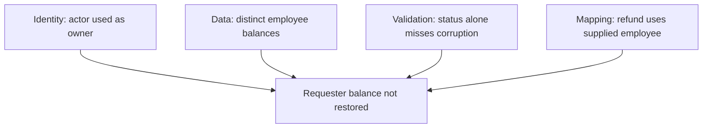
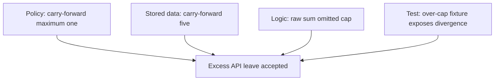

# Area 2 root-cause and Pareto contribution

24 November 2026. Prepared from source and retained automated evidence; this is
an analysis contribution for Wasay's review, not a record of a human triage meeting.

## Evidence and population

Failing-before build `1948e0f` ran 178 unique API cases: 169 passed, nine failed.
See `../evidence/area2/phase-c/ci-45183086568-job.log` and `ci-third-summary.json`.
The four narrow corrections were merged in [PR #2](https://github.com/includeduck/SQE-Horilla-Project/pull/2),
commit `2242c502090c81031e20df912b49809a03a1f523`.
[Run 45197384096](https://github.com/includeduck/SQE-Horilla-Project/actions/runs/45197384096)
then passed 14 focused regressions, eight affected upstream tests and 176 of the
178 full API cases. These are separate populations. Its full raw log is retained
as `../evidence/area2/phase-c/ci-45197384096-job.log`.

The remaining duplicate-allocation and cancelled-to-rejected failures require
business-oracle reconciliation and are excluded from the confirmed-defect
Pareto population below. Their genuine failing assertions remain enabled.
No confirmed-defect count is inferred from the number of failing parametrizations.

## A2-D01: refund credited the acting approver's balance

Severity High, priority P1, risk A2-R-BALANCE. Expected: rejecting an approved
three-day leave restores requester 2 to 5 and keeps approver at 7. Before the
correction the requester remained at 2. Reproducer:
`test_workflows.py::test_refund_belongs_to_requester`, plus the approved-to-rejected
transition case. The passing-after collection checks both users and the outsider.

| Why | Finding | Basis |
|---|---|---|
| 1. Why was the requester not restored? | The refund lookup selected the wrong employee's AvailableLeave. | Failing HTTP/state assertion and refund source |
| 2. Why was the wrong employee selected? | The PUT handler supplied `request.user.employee_get`. | Pre-fix `LeaveRequestRejectAPIView.put` |
| 3. Why does that identity differ? | A distinct reporting manager/approver performs rejection for the requester. | Non-superuser role fixture and real JWT HTTP operation |
| 4. Why could status still become rejected? | The status update did not prove that the refunded balance belonged to the leave's employee. | Handler/refund data flow and persisted state |
| 5. Why could this escape a shallow check? | A response/status-only assertion cannot detect cross-user balance corruption; distinct-user balance assertions expose it. | Inference from the demonstrated reproducer, not an assertion about historical team practices |

Correction: select `leave_request.employee_id` as the refund owner. Retest:
the focused refund and approved-reject regressions passed on the merged build;
affected upstream balance/carry-forward tests passed separately. Preventive
action: retain explicit requester/approver/outsider balance assertions after
every refund success, rejection and repetition. Wasay reviews this invariant
alongside unit coverage and future cancellation changes.

The diagram summarizes the evidenced contributing factors and correction;
it does not claim independent process causes were measured.

## A2-D03: API used uncapped carry-forward in validation

Severity High, priority P1, risk A2-R-BALANCE. Reproducer:
`test_workflows.py::test_carryforward_cap_used_in_balance_validation` sets
available 0, stored carry-forward 5, effective policy cap 1 and requests three
days. Before correction HTTP returned 201; expected 400 with no new record and
unchanged balances. The merged-build focused regression passed.

| Why | Finding | Basis |
|---|---|---|
| 1. Why was excess leave accepted? | Validation compared three requested days with the raw stored carry-forward five. | Failing 201-versus-400 assertion |
| 2. Why did the comparison use five? | The API added available and raw carry-forward directly. | Pre-fix `leave_Validations` |
| 3. Why should the effective amount be one? | The leave type enabled carry-forward with maximum one. | Fixture and `LeaveRequest.clean` policy oracle |
| 4. Why did model and API disagree? | They implemented separate balance calculations; the serializer omitted the policy cap. | Side-by-side source data flow |
| 5. Why does ordinary balance data miss this? | When stored carry-forward is already below its cap, raw and capped totals coincide. An over-cap fixture distinguishes them. | Logical inference validated by this targeted fixture |

Correction: apply the existing carry-forward policy and cap in API validation.
Retest: the cap regression and eight impacted upstream balance/file tests passed
in their separate collections. Preventive action: retain policy/cap combinations
with stale over-cap stored balances and compare response plus persisted state.
Forecast, employee-specific holidays and positive effective duration are separate
unfinished A2-D07 obligations; this correction does not certify those rules.

## Confirmed corrected defects and Pareto population

Population: four distinct reproduced/corrected endpoint defects, one category
per defect. A2-D02's PUT/DELETE failures and A2-D09's two filename boundaries are
multiple cases for their respective single defects.

| Category | Defects | Count | Share | Cumulative |
|---|---|---:|---:|---:|
| Balance owner/policy calculation | A2-D01, A2-D03 | 2 | 50% | 50% |
| Ownership denial handling | A2-D02 | 1 | 25% | 75% |
| Attachment path construction | A2-D09 | 1 | 25% | 100% |

This small observed population supports prioritizing balance regressions. It is
not a project-wide defect distribution, code-defect density, predicted failure
rate or proof of an 80/20 relationship. Reopen rate and human actual effort are
unavailable. Wasay must reconcile these contributions with real product Issues,
triage/closure records, the group report and final accepted scope. A coordination
issue is not counted as a product defect; no additional Issues were posted here.
