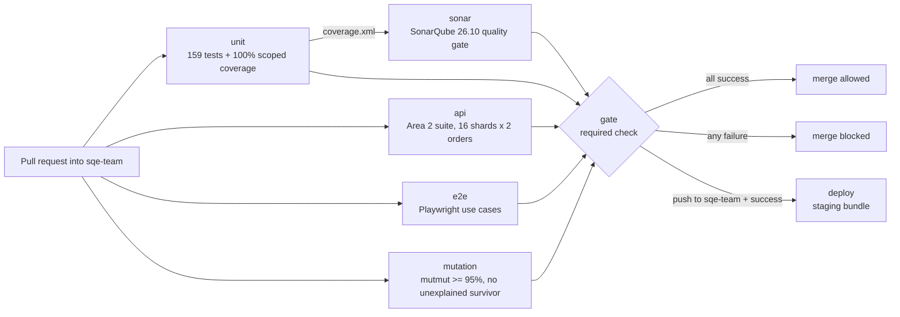

# CI Quality Gate (Area 1)

Owner: Muhammad Wasay Tariq (24I-3071). Brief §2: "GitHub Actions on every pull request: SonarQube, all tests and mutation. Block merge and deployment on failures or below the coverage, mutation and Sonar thresholds you justify. No escape hatches (continue-on-error, || true). Make one documented fix through a pull request (fails before, passes after), and include one pull request the pipeline blocked."

## 1. Pipeline

Workflow: [`.github/workflows/quality-gate.yml`](../../../.github/workflows/quality-gate.yml), triggered on every pull request into `sqe-team`, every push to `sqe-team`, and manually.

| Job | What it runs | Fails when |
|---|---|---|
| `unit` | `tests/team/unit` (Area 1) with branch coverage, then `coverage_scope.py` | any test fails, or any scoped business-logic function is below 100% statement/branch (apart from the justified infeasible gaps) |
| `api` | Area 2 API/integration suite via the reusable `finish02-coverage.yml` (full scope, sharded, both test orders) | any API case fails or the declared scope is incomplete |
| `e2e` | `tests/team/e2e` Playwright browser use cases (Chromium) | any browser flow fails |
| `sonar` | A throwaway **SonarQube 26.10.0.133078 Community** service container (same version as the local baseline). `sonar_gate.py setup` creates the project and the **"SQE Gate"** quality gate from `gate-thresholds.json`; `pysonar` analyses with the unit `coverage.xml`; `sonar_gate.py check` waits for the analysis and reads the gate status | the SonarQube quality gate is not OK |
| `mutation` | mutmut 3.8.1 with the custom business-rule operators on the 15 scoped functions, then `analyse.py` and `mutation_gate.py` | score below 95%, or a survivor not in the documented equivalent list |
| `gate` | Collects the result of all five jobs (`if: always()`) | any job is not `success`, including `skipped` or `cancelled` |
| `deploy` | Builds a staging bundle (`git archive` + SHA-256) as an artifact | never runs unless the event is a push to `sqe-team` **and** `gate` succeeded |

### Enforcement on GitHub

Branch protection on `sqe-team` (set 2026-11-26):

| Setting | Value |
|---|---|
| Required status check | **`gate`** |
| Include administrators | **on**: the repository owner cannot bypass the gate |
| Pull request required before merging | on |
| Force pushes / branch deletion | blocked |
| Conversation resolution required | on |

**Why one aggregate `gate` check:** GitHub treats a *skipped* required check as passing. If each job were required directly, a job skipped because an earlier job failed could let a PR through. `gate` always runs and fails unless every job reports `success`.

### No escape hatches

- No `continue-on-error` and no `|| true` anywhere in the workflow.
- Every step that pipes output (`… | tee …`) runs with `set -o pipefail`, so a failing command cannot be hidden by the pipe.
- The upstream Horilla workflow `docker-ci.yml` contains `continue-on-error` / `|| true`, but it only triggers on upstream branches and is not part of this gate.

## 2. Thresholds and justification

All thresholds live in [`docs/team/ci/gate-thresholds.json`](../ci/gate-thresholds.json).

| Gate | Threshold | Evidence / justification |
|---|---|---|
| Unit coverage | **100%** statement and branch on the 15 scoped functions; only the two documented infeasible branches allowed | The brief requires 100% of server-side business logic. `WHITEBOX_UNIT_TESTING.md` §2–3 shows it is achievable and lists the two infeasible branches with reasons. |
| Mutation score | **≥ 95%** on the scoped functions | Run 2 reached 97.9% with every non-equivalent mutant killed (`MUTATION_TESTING.md` §3). 95% leaves room for a few new equivalent mutants in new code while failing any change that drops a whole tested rule. |
| Mutation survivors | **0 unexplained**: every survivor must match `mutation-equivalents.json` (function + changed lines) | The score alone could hide a newly untested rule behind 2.1% of headroom; this rule cannot. The 10 listed equivalents are justified in `MUTATION_TESTING.md` §5. |
| SonarQube `bugs` | fails if **> 38** | Baseline scan 2026-11-25 = 38: no new bugs. Most are in modules outside our scope, so the gate prevents regression rather than demanding Horilla be rewritten. |
| SonarQube `vulnerabilities` | fails if **> 62** | Baseline 62: no new vulnerabilities. |
| SonarQube `code_smells` | fails if **> 45** | Baseline 45: no new code smells. |
| SonarQube `duplicated_lines_density` | fails if **> 3.0%** | Baseline 2.9%; 0.1 tolerance for rounding when files are added. |
| SonarQube `coverage` | fails if **< 2.0%** | Baseline 2.3% from the unit run. It proves the coverage report was imported (missing `coverage.xml` = 0%). Real coverage is enforced per function by the unit job, because SonarQube reports coverage per file, not per function. |

The SonarQube conditions are on **overall code** because the CI server is created fresh for every run: with no previous analysis there is no "new code" period, so "new code" conditions would never apply. Using the baseline values on overall code gives the same "no regression" effect.

First green run on the gate PR ([#33](https://github.com/includeduck/SQE-Horilla-Project/pull/33), run 45809133261) measured exactly the local baseline: bugs 38, vulnerabilities 62, code smells 45, duplication 2.9%, coverage 2.3%; mutation 475 mutants, 97.9%, 10 survivors all documented equivalents; unit 159 passed, scoped coverage PASS.

## 3. Pull request blocked by the pipeline

**PR [#34](https://github.com/includeduck/SQE-Horilla-Project/pull/34) "[DEMO - do not merge] Remove forecast balance test"**, quality-gate run [45816864805](https://github.com/includeduck/SQE-Horilla-Project/actions/runs/45816864805).

The PR deletes one unit test, `test_forecast_of_next_reset_counts_towards_balance` (BR-01 forecast term), and changes nothing else.

| Job | Result | Why |
|---|---|---|
| unit (158 tests + scoped coverage) | **success** | every remaining test passes and scoped coverage is still 100%: coverage cannot see that a test is missing |
| api (Area 2 suite) | success | API tests do not depend on the deleted unit test |
| e2e | success | |
| sonar | success | no code change, so no new issues |
| **mutation** | **failure** | score **97.3%** (above the 95% threshold) but **3 unexplained survivors**, exactly the forecast-term mutants: `forcasted_leaves(None)`, `+ forcated_days` → `- forcated_days`, and the custom `balance_term_drop` mutant `(available_days + carryforward_days)` |
| **gate** | **failure** | mutation did not succeed |
| deploy | skipped | gate failed |

GitHub marked the PR **BLOCKED** by the required `gate` check; it was closed without merging, with the run linked in a comment.

**What it shows:** a tests-plus-coverage pipeline would have merged this PR. A score threshold alone would also have let it through (97.3% ≥ 95%). The "no unexplained survivor" rule is what blocks the removal of a whole tested rule.

## 4. Documented fix through a pull request (fails before, passes after)

**PR [#35](https://github.com/includeduck/SQE-Horilla-Project/pull/35) "Fix #11: leave request without end date crashes validation"** (defect [#11](https://github.com/includeduck/SQE-Horilla-Project/issues/11), A1-D01).

| Step | Commit | Change | Gate result |
|---|---|---|---|
| **Fails before** | `4b89899` | Test only: the test that pinned the `TypeError` is replaced by `test_missing_end_date_is_a_single_day_request` and `test_missing_end_date_still_checks_balance` | Run [45816920422](https://github.com/includeduck/SQE-Horilla-Project/actions/runs/45816920422): **unit failed** with `TypeError: '>' not supported between instances of 'datetime.date' and 'NoneType'` at `leave/models.py:2069`; **mutation failed** (mutmut's clean-test run fails on the same test); **gate failed**, PR blocked |
| **Passes after** | `9487a2e` | `LeaveRequest.clean()` defaults `end_date` to `start_date` before the date checks; the justified coverage gaps follow the shifted lines | Locally: unit **160 passed**, scoped coverage PASS, mutation gate PASS (477 mutants, 97.9%, 0 unexplained). In CI: verified in the integration PR's gate run (§6) |

The same pattern was used for the high-severity fix of #46 (PR #51): the test-only commit `213c7bb` made 2 of 5 recovery tests fail, the fix commit made all 5 pass (`docs/team/evidence/recovery/fix-46-before.txt`, `fix-46-after.txt`).

## 5. Operating the gate: CI capacity

On 26 Nov eight pull requests were open at once. Every gate run starts ~35 jobs (the Area 2 API suite is sharded 16 × 2 orders) and Area 2's own workflows ran the same tests again on each PR, so about 500 jobs queued behind the free runner limit (~20 concurrent jobs). The queued runs were cancelled and the eight PRs were combined into one integration PR, which needed a single gate run. The required check and owner-bypass rules were unchanged.

## 6. Integration run

_To be filled with the integration PR's gate run once it completes._

## 7. How to run the pieces locally

| Piece | Command |
|---|---|
| Unit + coverage gate | `python -m pytest -c tests/team/pytest-unit.ini tests/team/unit --cov=leave --cov=horilla_api.api_views.leave --cov-branch --cov-report=json:coverage.json` then `python tests/team/unit/coverage_scope.py coverage.json` |
| Mutation gate (WSL/Linux) | `python tests/team/mutation/run_mutmut.py run`, `python tests/team/mutation/analyse.py --out out/`, `python tests/team/ci/mutation_gate.py out/summary.json` |
| SonarQube | local server + `pysonar` as in `SONARQUBE_BASELINE.md` |
