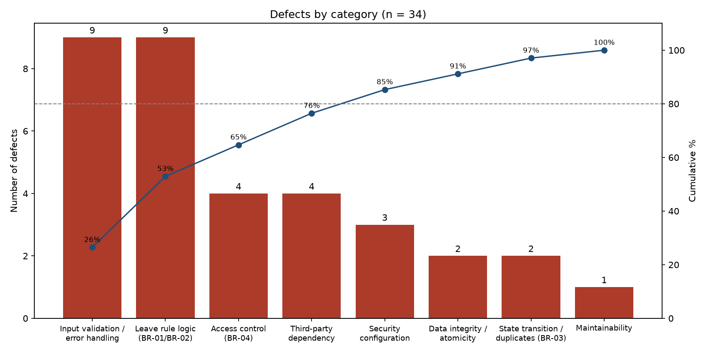
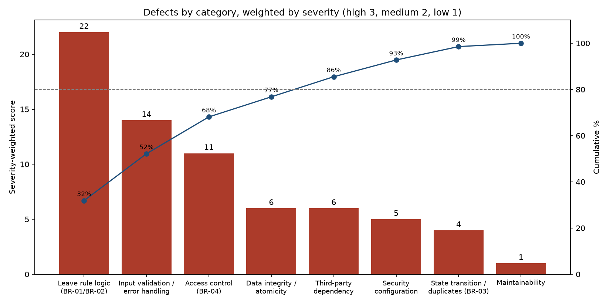
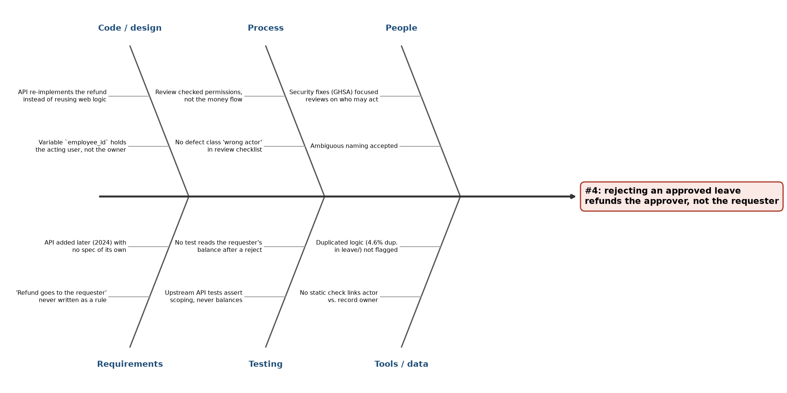
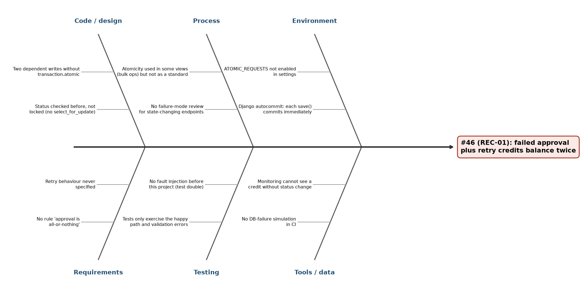

# Defect Management and Root Cause Analysis

Shared test-management document (brief §2: "Defects: GitHub Issues with severity, priority, status and triage decision. Root cause analysis (5 Whys + fishbone) for at least 2 major defects, with corrective and preventive actions. Pareto by category."). Prepared by Muhammad Wasay Tariq (24I-3071), 2026-11-26; defects were found and logged by all areas (Area 1 white-box, Area 2 API, Area 3 security/recovery).

## 1. Defect management process

**Tool:** GitHub Issues in the team repository; every defect carries the label `defect` plus:

| Label group | Values | Meaning |
|---|---|---|
| `severity:` | `high` / `medium` / `low` | **High:** wrong balance, cross-employee access or lost data in a core workflow. **Medium:** wrong result or server error (HTTP 500) on a realistic input, workaround exists. **Low:** robustness, cosmetic, or needs unusual data |
| `priority:` | `P1` / `P2` / `P3` | Fix order: P1 before release; P2 this cycle; P3 when convenient |
| `triage:` | `accepted` / `deferred` / `rejected` | Triage decision: accepted = will be fixed; deferred = known, outside the selected workflows or with a compensating control; rejected = not a defect |
| `category:` | 8 categories (§3) | Used for the Pareto analysis |
| `source:` | `api`, `white-box`, `browser`, `security`, `recovery` | Which test activity found it |
| `status:` | `status:fixed-verified`, or open/closed | Fixed and verified by a passing regression test in the CI gate |

**Lifecycle:** *open* → *triaged* (severity, priority, triage decision) → *fix in a pull request* with a regression test that fails before and passes after → *verified* (the required `gate` check passes on `sqe-team`) → *closed*. Known defects that are not fixed yet stay visible as strict `xfail` tests (e.g. REC-01), so the run fails as soon as someone fixes them without updating the test.

**Reproducible log:** [`scripts/team/defect_pareto.py`](../../../scripts/team/defect_pareto.py) exports every issue labelled `defect` to [`defects/DEFECT_LOG.csv`](../defects/DEFECT_LOG.csv) and draws the Pareto charts, so the analysis can be regenerated after any triage change.

## 2. Defect log (2026-11-27)

**34 defects:** 10 high, 15 medium, 9 low. **25 fixed and verified**: 24 closed (corrections from PR #2/#8 and integration PR #52, each with a regression test in the required gate) plus #54, whose fix and regression test are in PR #53. **9 open**: white-box #12, #13 and security #38–#44. Found by: API testing 22, security 7, white-box 3, browser 1, recovery 1.

| # | Title | Source | Category | Severity | Priority | Triage | Status |
|---|---|---|---|---|---|---|---|
| [#3](https://github.com/includeduck/SQE-Horilla-Project/issues/3) | A2-D09: accepted extensionless attachment filenames fail storage at 99/100 … | api | input-validation | medium | P3 | accepted | fixed-verified |
| [#4](https://github.com/includeduck/SQE-Horilla-Project/issues/4) | A2-D01: rejecting approved leave refunds the acting approver instead of req… | api | leave-rule-logic | high | P1 | accepted | fixed-verified |
| [#5](https://github.com/includeduck/SQE-Horilla-Project/issues/5) | A2-D02: foreign-owned self-allocation PUT and DELETE return 500 | api | access-control | high | P1 | accepted | fixed-verified |
| [#6](https://github.com/includeduck/SQE-Horilla-Project/issues/6) | A2-D03: API leave creation ignores carry-forward policy cap | api | leave-rule-logic | high | P2 | accepted | fixed-verified |
| [#11](https://github.com/includeduck/SQE-Horilla-Project/issues/11) | A1-D01: leave request without end date crashes validation with TypeError | white-box | input-validation | medium | P2 | accepted | fixed-verified |
| [#12](https://github.com/includeduck/SQE-Horilla-Project/issues/12) | A1-D02: dead code in LeaveRequest.clean month/year comparison (line 2141) | white-box | maintainability | low | P3 | deferred | open |
| [#13](https://github.com/includeduck/SQE-Horilla-Project/issues/13) | A1-D03: unknown carry-forward type adds stored carry-forward days uncapped | white-box | leave-rule-logic | low | P3 | accepted | open |
| [#14](https://github.com/includeduck/SQE-Horilla-Project/issues/14) | A2-P3-01: API accepts zero and negative effective leave duration | api | leave-rule-logic | high | P1 | accepted | fixed-verified |
| [#15](https://github.com/includeduck/SQE-Horilla-Project/issues/15) | A2-P3-02: API excludes another employee's specific holiday and accepts an o… | api | leave-rule-logic | high | P2 | accepted | fixed-verified |
| [#16](https://github.com/includeduck/SQE-Horilla-Project/issues/16) | A2-P3-03: API refuses valid forecast entitlement at and after the reset bou… | api | leave-rule-logic | medium | P2 | accepted | fixed-verified |
| [#17](https://github.com/includeduck/SQE-Horilla-Project/issues/17) | A2-P3-04: API rejects complementary non-overlapping half-day leave requests | api | leave-rule-logic | medium | P3 | accepted | fixed-verified |
| [#18](https://github.com/includeduck/SQE-Horilla-Project/issues/18) | A2-P3-05: Approval ignores current carry-forward policy/cap | api | leave-rule-logic | high | P2 | accepted | fixed-verified |
| [#19](https://github.com/includeduck/SQE-Horilla-Project/issues/19) | A2-P3-06: Malformed approved-allocation rejection deducts balance before re… | api | data-integrity | high | P1 | accepted | fixed-verified |
| [#20](https://github.com/includeduck/SQE-Horilla-Project/issues/20) | A2-P3-07: Generic update lets an ordinary owner transfer a request to anoth… | api | access-control | high | P1 | accepted | fixed-verified |
| [#21](https://github.com/includeduck/SQE-Horilla-Project/issues/21) | A2-P2-01: Malformed employee identifiers crash the target permission lookup | api | input-validation | medium | P2 | accepted | fixed-verified |
| [#22](https://github.com/includeduck/SQE-Horilla-Project/issues/22) | A2-P2-02: Non-object API bodies crash server-owned identity injection | api | input-validation | medium | P2 | accepted | fixed-verified |
| [#23](https://github.com/includeduck/SQE-Horilla-Project/issues/23) | A2-P2-03: Invalid groupby_field escapes as an API server error | api | input-validation | low | P3 | accepted | fixed-verified |
| [#24](https://github.com/includeduck/SQE-Horilla-Project/issues/24) | A2-P2-04: Generic allocation creation accepts an unauthorized foreign employee | api | access-control | high | P1 | accepted | fixed-verified |
| [#25](https://github.com/includeduck/SQE-Horilla-Project/issues/25) | A2-P2-05: Zero detail IDs lose the route argument in permission dispatch | api | access-control | medium | P2 | accepted | fixed-verified |
| [#26](https://github.com/includeduck/SQE-Horilla-Project/issues/26) | A2-P2-06: Malformed AJAX relation filter choices crash before form validation | api | input-validation | low | P3 | accepted | fixed-verified |
| [#27](https://github.com/includeduck/SQE-Horilla-Project/issues/27) | A2-P2-07: Sessionless JWT HTML API responses crash sidebar menu construction | api | input-validation | low | P3 | accepted | fixed-verified |
| [#28](https://github.com/includeduck/SQE-Horilla-Project/issues/28) | A2-P2-08: Malformed registered advanced date filters return 500 | api | input-validation | low | P3 | accepted | fixed-verified |
| [#29](https://github.com/includeduck/SQE-Horilla-Project/issues/29) | A2-D04: Identical pending allocation submissions create duplicate records | api | state-transition | medium | P2 | accepted | fixed-verified |
| [#30](https://github.com/includeduck/SQE-Horilla-Project/issues/30) | A2-D05: Ordinary rejection accepts an already cancelled leave request | api | state-transition | medium | P2 | accepted | fixed-verified |
| [#31](https://github.com/includeduck/SQE-Horilla-Project/issues/31) | A2-D10: Browser allocation form accepts an empty requested-days amount | browser | input-validation | medium | P2 | accepted | fixed-verified |
| [#38](https://github.com/includeduck/SQE-Horilla-Project/issues/38) | SEC-01: web allocation approval changes state on a plain GET (CSRF bypass) | security | security-config | medium | P2 | accepted | open |
| [#39](https://github.com/includeduck/SQE-Horilla-Project/issues/39) | SEC-02: no Content-Security-Policy header on any page | security | security-config | medium | P2 | accepted | open |
| [#40](https://github.com/includeduck/SQE-Horilla-Project/issues/40) | SEC-03: vulnerable moment.js 2.29.1 bundled in static files | security | dependency | medium | P3 | accepted | open |
| [#41](https://github.com/includeduck/SQE-Horilla-Project/issues/41) | SEC-04: CDN scripts loaded without Subresource Integrity | security | dependency | medium | P3 | accepted | open |
| [#42](https://github.com/includeduck/SQE-Horilla-Project/issues/42) | SEC-05: pdfkit 1.0.0 advisory (PYSEC-2026-2860) with no upstream fix | security | dependency | low | P3 | deferred | open |
| [#43](https://github.com/includeduck/SQE-Horilla-Project/issues/43) | SEC-06: svglib 1.5.1 DoS advisory (fixed in 2.3.1) | security | dependency | low | P3 | accepted | open |
| [#44](https://github.com/includeduck/SQE-Horilla-Project/issues/44) | SEC-07: CSRF token sent in a GET query string | security | security-config | low | P3 | accepted | open |
| [#46](https://github.com/includeduck/SQE-Horilla-Project/issues/46) | REC-01: allocation approval is not atomic; a failed write plus retry credit… | recovery | data-integrity | high | P1 | accepted | fixed-verified |
| [#54](https://github.com/includeduck/SQE-Horilla-Project/issues/54) | TZ-01: today's-leave filter uses the UTC date instead of the local date | api | leave-rule-logic | medium | P2 | accepted | fixed in PR #53 |

## 3. Pareto analysis by category

| Category | Defects | Cumulative % | Severity-weighted (H=3, M=2, L=1) | Weighted rank |
|---|---|---|---|---|
| Leave rule logic (BR-01/BR-02) | 9 | 26% | **22** | **1st** |
| Input validation / error handling | 9 | 53% | 14 | 2nd |
| Access control (BR-04) | 4 | 65% | 11 | 3rd |
| Third-party dependency | 4 | 76% | 6 | 5th |
| Security configuration | 3 | 85% | 5 | 6th |
| Data integrity / atomicity | 2 | 91% | 6 | 4th |
| State transition / duplicates (BR-03) | 2 | 97% | 4 | 7th |
| Maintainability | 1 | 100% | 1 | 8th |

**Reading the Pareto:**
- By count, **2 of 8 categories (25%) hold 53% of the defects** and the first **5 categories pass 80%**. The 80/20 shape is weaker than usual because the security scan added several small categories at once.
- By count, **input validation** ties for first: nine paths where malformed or missing input ended in an HTTP 500 instead of a validation message (malformed ids, non-object bodies, bad filters, a missing end date). They share one root cause: request data reaches ORM queries or comparisons before it is validated.
- **Weighted by severity, leave-rule logic moves to first place** (22 of 69 points). Most of them silently change a balance (#4, #6, #14, #15, #18); #54 shows the wrong "on leave today" list for 5½ hours a day. Leave-rule logic, input validation and access control together carry **68%** of the weighted severity.
- **Action:** the depth given to PR-01/PR-02 (balance) and PR-03 (access) in the risk register is confirmed. The input-validation cluster argues for one shared fix, validating the request shape at the API boundary, which PR #8 introduced as `_request_object()` / `_filtered_queryset()`.

## 4. Root cause analysis

### 4.1 #4: rejecting an approved leave refunds the approver instead of the requester

| | |
|---|---|
| Severity / priority | High / P1 (category: leave rule logic; risk **PR-01**) |
| Found by | Area 2 API test `test_refund_belongs_to_requester` (reads back both balances) |
| Symptom | `PUT /api/leave/reject/<id>/` on an approved leave adds the refunded days to the **approver's** balance (or fails if the approver has none); the requester's balance stays reduced |

**5 Whys**

| # | Why? | Because |
|---|---|---|
| 1 | Why did the refund go to the approver? | `LeaveRequestRejectAPIView.put` passed `employee_id = request.user.employee_get` (the **acting user**) to `leave_calculation`, which looks up `AvailableLeave` by that employee |
| 2 | Why was the acting user used? | The API view re-implemented the refund instead of reusing the web view's logic; the web views in `leave/views.py` use `leave_request.employee_id` correctly in all three refund paths |
| 3 | Why was the logic re-implemented? | The REST API was added in one large change (commit `932930913`, 2024-10-10) as a parallel layer, with no shared service function for "refund a leave request" |
| 4 | Why did tests and review not catch it? | Upstream API tests (`horilla_api/tests/test_leave_request_write_scoping.py`) check **who may act** (scoping, permissions) but never read the **requester's balance** after a reject; the API code shows review attention went to access control (security advisories referenced in comments) |
| 5 | Why was there no balance assertion? | "The refund belongs to the requester" was never written down as a rule, so no test oracle existed until this project's test basis (FR-09) |

**Root cause:** duplicated balance-changing logic in the API layer, with no written rule or test oracle for *whose* balance changes.

| Action | Type | Status |
|---|---|---|
| Use `leave_request.employee_id` in the API reject view | Corrective | **Done** (PR #2, merged) |
| Regression tests: API `test_refund_belongs_to_requester`; unit `test_reject_approved_leave_refunds_requester` and `test_reject_leave_refunds_only_matching_row` (requester, approver and an unrelated row) | Corrective | **Done**, run by the CI gate |
| Mutation testing with filter-dropping mutants on the refund lookup (all killed since run 2) | Preventive | **Done** |
| Move "credit / debit / refund a balance" into one service function used by both web and API views | Preventive | Proposed |
| Test rule: every balance-changing test asserts the **requester, the actor and an unrelated employee** | Preventive | Adopted in the unit and API suites |
| Review checklist item "actor vs. record owner" for every state-changing endpoint | Preventive | Proposed |

### 4.2 #46 (REC-01): failed approval plus retry credits the balance twice

| | |
|---|---|
| Severity / priority | High / P1 (category: data integrity; risks **PR-01**, PR-06) |
| Found by | Area 3 failure-and-recovery test (a test double makes the database fail between the two writes) |
| Symptom | Balance 5 → **8** after the failed approval (request still `requested`) → **11** after the retry: a 3-day allocation gives 6 days |

**5 Whys**

| # | Why? | Because |
|---|---|---|
| 1 | Why was the balance credited twice? | The retry passed the `status == "requested"` check and ran the credit again |
| 2 | Why was the status still `requested`? | The first attempt committed the balance credit (`AvailableLeave.save`) but failed before `LeaveAllocationRequest.save` set `approved` |
| 3 | Why could one write commit without the other? | The writes are not in a transaction: Django autocommits each `save()`, `ATOMIC_REQUESTS` is not enabled, and neither the API (`LeaveAllocationApproveAPIView.put`) nor the web helper (`_approve_leave_allocation`) uses `transaction.atomic` |
| 4 | Why was no transaction used? | Atomicity is applied ad hoc: `leave/views.py` uses `transaction.atomic` only in the bulk operations `leave_assign` and `leave_request_import`; there is no rule that every multi-write state change is atomic |
| 5 | Why was it never noticed? | No test simulated a failure between writes; existing tests cover success paths and validation errors, where both writes always succeed together |

**Root cause:** no atomicity standard for multi-write state changes, and no fault-injection testing to reveal partial writes.

| Action | Type | Status |
|---|---|---|
| Wrap credit + status change in `transaction.atomic()` and lock the request (`select_for_update`) | Corrective | Proposed (#46); the strict `xfail` test turns red when it is fixed |
| Apply the same to leave approve/reject and allocation reject (same two-write pattern) | Corrective | Proposed |
| Keep the failure-and-recovery tests in the CI gate (`tests/team/recovery`) | Preventive | **Done** |
| Rule "every endpoint that writes more than one row is atomic", plus a review checklist item | Preventive | Proposed |
| Evaluate `ATOMIC_REQUESTS = True` for the API after measuring its effect | Preventive | Proposed |

## 5. Weaknesses linked to the risk register

| Risk (RISK_REGISTER.md) | Defects that materialised it | Effect on the register |
|---|---|---|
| PR-01 balance changes wrong (25) | #4, #19, #46 | Likelihood 5 confirmed; #46 still open, so residual risk stays high |
| PR-02 balance boundary (20) | #6, #13, #14, #15, #16, #18 | Confirmed; all fixed and verified except #13 (low) |
| PR-03 cross-employee access (20) | #5, #20, #24, #25, #38 (CSRF on GET approval) | Confirmed; #38 open (medium) |
| PR-04 invalid state transitions (16) | #30 | Fixed and verified |
| PR-05 malformed input → 500 (15) | #3, #11, #21, #22, #23, #26, #27, #28, #31 | Largest category by count; #11 fixed in PR #35 |
| PR-06 duplicates (12) | #29, #46 (duplicate credit on retry) | #29 fixed; #46 open |
| PR-07 / PR-08 day counting, overlap (12) | #15, #17, #54 | Fixed and verified (#54 in PR #53) |
| PR-09 vulnerable dependency (9) | #40, #41, #42, #43 | Open; #42 deferred (outside the workflows, compensating control) |
| PR-10 performance (6) | none (worst p95 39 ms) | Low rating confirmed |
| PR-11 accessibility (6) | A11Y-01–13 (ACCESSIBILITY_TESTING.md); fixed screen meets EC-5 | Residual moderate items |
| (not in the original register) security configuration | #39, #44 | Recorded as further evidence for PR-03 / PR-09 |

**Defect density** (input for the GQM metrics in the progress report): 34 defects in the scoped code (`leave/` 14.47 KLOC + `horilla_api/api_views/leave/` 1.10 KLOC ≈ 15.6 KLOC) ≈ **2.2 defects/KLOC**; high severity ≈ 0.64/KLOC.
