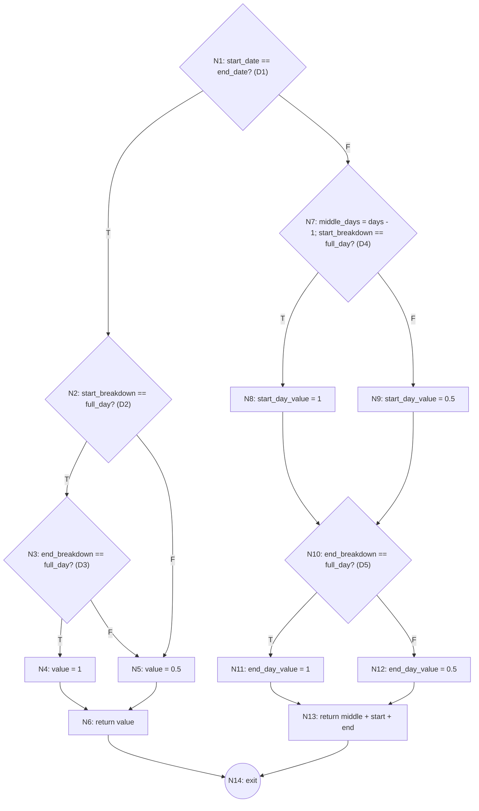

# SonarQube Baseline Analysis (Area 1)

Owner: Muhammad Wasay Tariq (24I-3071). Brief §2: "Run SonarQube on the project. Report the relevant metrics … and explain what each shows. Hand-calculate cyclomatic complexity for one business-rule function from its CFG and compare it with SonarQube."

## 1. Analysis setup

| Item | Value |
|---|---|
| Server | SonarQube Community Build **26.10.0.133078**, local (`http://localhost:9000`) |
| Scanner | `pysonar` 1.11.0.6012 (Python scanner), run from Windows |
| Code analysed | `sqe-team` @ `2242c5020` (Horilla 2.4.0 baseline + Rayyan's merged defect fixes) |
| Config | [`sonar-project.properties`](../../../sonar-project.properties): all first-party Python; excludes migrations, demo fixtures, static/templates, virtualenv, docs, scripts; test code counted as tests |
| Quality profile | **Sonar way core** (server default for Python in 26.x, 232 active rules) |
| Quality gate | Sonar way (default) |
| Analysis date | 2026-11-25 |
| Raw evidence | [`evidence/sonar/baseline-measures.jsonl`](../evidence/sonar/baseline-measures.jsonl), [`evidence/sonar/baseline-issues.json`](../evidence/sonar/baseline-issues.json) |

All 1,267 Python source files were parsed (scan log: no parse failures; 84 directories skipped by the exclusion patterns).

## 2. Metrics and what each shows

| Metric | Whole project | `leave/` | `horilla_api/api_views/leave/` | What it shows |
|---|---|---|---|---|
| Lines of code (ncloc) | 230,396 | 14,470 | 1,102 | Size. Our module is ~6.3% of the code base, but contains the business rules we test. |
| Files / functions / classes | 970 / 9,369 / 2,928 | – / 527 / – | – / 86 / – | Size and structure; 527 functions in `leave/` sets the scale for unit testing. |
| **Cyclomatic complexity** | 33,040 | 1,947 | 184 | Number of independent paths (≈ minimum test cases for branch coverage). `leave/` averages **3.7 per function**, but it is concentrated: `LeaveRequest.clean` alone holds most of the balance/overlap/restriction decisions. |
| Cognitive complexity | 37,251 | 2,543 | 146 | How hard the code is for a human to follow (penalises nesting). `leave/` is higher than its cyclomatic value → deeply nested logic, a maintainability risk. |
| **Duplication** (lines %) | 2.9% (8,988 lines, 438 blocks) | **4.6%** | 2.1% | Copy-pasted code. `leave/` is above the project average: a fix in one copy can be missed in another (exactly how A2-D01 refund logic could diverge between views). |
| **Bugs** (classic) / reliability issues (MQR) | 38 / 65 | 1 / 2 | 1 / 1 | Code that will likely misbehave at runtime. |
| **Reliability rating** | **E (5.0)** | **E** | C | Driven by the worst issue: E means at least one blocker bug exists. |
| **Vulnerabilities** / security issues (MQR) | 62 / 64 | 0 | 0 | Code open to attack. None in the leave module itself. |
| **Security rating** | **D (4.0)** | A | A | Worst project vulnerability is high severity. |
| Security hotspots / review rating | 0 / A | 0 | 0 | Security-sensitive code needing manual review (in 26.x most hotspot-type rules are reported as issues instead). |
| **Code smells** (classic) / maintainability issues (MQR) | 45 / 29 | 1 / 1 | 0 / 0 | Maintainability problems. Low count is partly the lean *Sonar way core* profile (see §4). |
| **Technical debt** | 298 min classic (203 min MQR) | 2 min | 0 | Estimated time to fix all maintainability issues. |
| Debt ratio / **maintainability rating** | 0.0% / **A** | A | A | Debt ÷ estimated cost to rewrite; tiny relative to 230k LOC, so rated A. |
| **Coverage** (line / branch) | **0.0%** | 0.0% | 0.0% | No team unit-test coverage report yet (`coverage.xml` absent). This is the "before" value; Area 1 unit tests must raise `leave/` business logic to 100% statement + branch. |
| Comment density | 16.2% | – | – | Share of comment lines. |
| Quality gate | Passed | – | – | Not meaningful on a first scan: the default gate only checks *new code*, and nothing is new yet. Our CI gate will define its own conditions on overall code (§5). |

Issue severities (MQR impact): **26 blocker, 16 high, 84 medium, 30 low**. By software quality: reliability 65, security 64, maintainability 29 (one issue can impact several qualities).

## 3. Findings relevant to our scope

| Rule | Location | Finding | Meaning for us |
|---|---|---|---|
| python:S5644 (bug, blocker) | `leave/views.py:143` | Claims `response` does not support `__setitem__` (would be a `TypeError`) | **Likely false positive** on manual review: `response = HorillaFormView.HttpResponse()` is a Django `HttpResponse`, which does support `response["HX-Trigger"] = …`; SonarQube cannot infer the type through the class attribute. To confirm with a unit test, then mark *False positive* in SonarQube with this justification. Until then this one issue is why `leave/` is rated **E** for reliability: an example of a rating driven by a single tool finding. |
| python:S1763 (bug) | `horilla_api/api_views/leave/views.py:1189` | Unreachable `return Response(status=200)` directly after `raise serializers.ValidationError(...)` | Confirmed on review: dead code in the API layer we test. It cannot be covered, so it is justified as uncoverable in the 100% coverage argument (or removed). |
| python:S8510 (smell) | `leave/models.py:1322` | Loop variable `i` shadows an outer loop variable | In balance-related model code; maintainability risk, may hide a logic error. |

Top project-wide rules: S2245 pseudorandom generator (30), S3752 endpoint accepts all HTTP methods (23), S1656 useless self-assignment (18), S8519 `list(...)[0]` (16), S1845 name clash (11), S3516 method always returns same value (7), S930 missing call arguments (4, would raise `TypeError`). Most issues sit in `base/management/commands`, `base`, `recruitment/views` and `horilla_views`: outside our module.

**Risk reading:** the leave module is small, well-rated for maintainability and security, but has (a) a reliability rating of E from one blocker finding that still needs confirming (likely a false positive), (b) above-average duplication, and (c) its complexity concentrated in a few large functions. This supports rating "incorrect balance / state change" as a high product risk and choosing white-box + MC/DC depth for `LeaveRequest.clean` and the approve/reject/refund paths.

## 4. Limitations

- **Profile:** SonarQube 26.x defaults Python to *Sonar way core* (232 rules); *Sonar way extended* (266) and *comprehensive* (407) exist. Issue counts would be higher with them, so counts are compared only against the same profile in later scans.
- **Classic vs MQR metrics:** 26.x reports both. The classic `code_smells`/`bugs` and the MQR `software_quality_*` counts differ because MQR classifies each issue by impact. Both are stored in the evidence file.
- **Coverage 0%** is a baseline, not a finding about Horilla's own tests: upstream tests are not run, as they earn no marks.

## 5. Inputs for the CI quality gate (to be justified in the gate design)

Baseline values the gate thresholds will be set against: coverage of the leave business-logic files (target 100% statement + branch), no new blocker/high issues, duplication on new code ≤ 3% (project average 2.9%), reliability and security rating on new code = A. Mutation thresholds come after the first mutation run.

## 6. Hand-calculated cyclomatic complexity: `calculate_requested_days`

**Why this function:** it implements the day-counting part of **BR-01** (requested days vs balance) and is called by every leave request before the balance check. It is small enough to draw a complete CFG.

Source (`leave/methods.py`, lines 13–30, unchanged from upstream):

```python
def calculate_requested_days(start_date, end_date, start_date_breakdown, end_date_breakdown):
    if start_date == end_date:                                           # D1
        return (
            1
            if start_date_breakdown == "full_day" and end_date_breakdown == "full_day"  # D2, D3
            else 0.5
        )
    middle_days = (end_date - start_date).days - 1
    start_day_value = 1 if start_date_breakdown == "full_day" else 0.5   # D4
    end_day_value = 1 if end_date_breakdown == "full_day" else 0.5       # D5
    return middle_days + start_day_value + end_day_value
```

The `and` short-circuits, so in the CFG its two operands are separate decision nodes (D2, D3).

### Control-flow graph



### Calculation

| Method | Working | V(G) |
|---|---|---|
| Edges and nodes | E = 18, N = 14, P = 1 connected component: V(G) = E − N + 2P = 18 − 14 + 2 | **6** |
| Predicate nodes | 5 binary decisions (D1–D5): V(G) = 5 + 1 | **6** |
| Regions | 5 bounded regions + 1 outer region | **6** |

### Comparison with SonarQube

The function was copied unchanged into an isolated file and scanned as its own project (`sqe-cc-calculate-requested-days`) so SonarQube's file-level complexity equals the function's complexity:

| | Cyclomatic complexity |
|---|---|
| Hand calculation (CFG) | **6** |
| SonarQube 26.10 (`complexity`) | **6** |

They **agree**. SonarQube's Python metric counts +1 for the function, +1 for each `if` / conditional expression, and +1 for each boolean operator (`and`), which is exactly the predicate-node count used above (1 + `if` + 3 conditional expressions + 1 `and` = 6). SonarQube's *cognitive* complexity for the same function is also 6, a coincidence here (cognitive adds +1 for the `if`, +1 per conditional expression, and +1 for the `and` sequence, without nesting penalties at this depth).

**Testing implication:** V(G) = 6 means at least 6 independent paths, so branch coverage of this function needs test inputs for: same day + both full (1); same day + start half (0.5); same day + start full / end half (0.5); multi-day with each of start full/half and end full/half. The `and` is also an MC/DC candidate: D2 and D3 each need an independence pair.
